# 图 Baseline 实验报告：任务拆解、工程约束与六个模块的落地

| 项目 | 内容                |
| ---- | ------------------- |
| 姓名 | 甘锦珊              |
| 学号 | 24325083            |
| 课程 | 数据结构            |
| 日期 | 2026 年 11 月 25 日 |

---

### 一、项目概述

本实验完成图结构 Baseline 的六个模块：邻接表、邻接矩阵、无权最短路、Dijkstra、Prim、Kruskal。题面已经给出每个模块的 `.hpp` 接口和 `.cpp` 骨架，建图、加边、打印、参数校验都已实现，只留下标注 `TODO(student)` 的算法函数。我的工作不是从零写六个算法，而是**在固定接口上补全实现，并建立一套能反复验证的工程流程**。

最终交付六个模块的源码、六个测试驱动、一份通用比对脚本和顶层 Makefile；25 个公开用例全部逐行通过，编译零警告，六个 `.hpp` 与题面逐字一致。

这份报告不重复讲义里的算法定义和推导，重点写三类自己的判断：整体方案怎么定、实现里哪些地方需要做取舍、以及 prompt 是怎么设计和验收的。

---

### 二、整体方案

#### 2.1 为什么在骨架上补 TODO，而不是重写

题面把建图、加边、打印、边界校验都写好了，这些代码决定了数据结构长什么样，也决定了测试驱动的输入输出。如果让智能体从零重写，很容易出现两个问题：一是接口签名被改动，和题面不一致；二是已经正确的建图逻辑被换掉，反而引入新错误。

所以我的处理是：**先把 `src/Graph/Baseline/src/` 的骨架原样复制到 `MyLab/Graph/Baseline/`，只允许改 `TODO(student)` 的函数体**，`.hpp` 一个字符都不动。这样验收时可以直接 diff 头文件，确认接口没有漂移；出问题时也能快速判断是算法写错，还是建图部分被改坏。

#### 2.2 目录与构建的约定

交付目录分成 `code/` 和顶层 Makefile 两层：源码、驱动、测试数据都在 `code/`，Makefile 在顶层，编译产物统一放顶层 `build/`。这样做的好处是 `make clean` 只要删一个目录，`.gitignore` 也只要忽略一个 `build/`，不用去六个模块目录里分别找 exe。

构建上定了几条硬约定，都是为了在 Windows 的 `cmd.exe` 和类 Unix 的 `sh` 下都能跑：

- 目标名统一带 `$(EXEEXT)`，Windows 下自动变成 `.exe`；
- Windows 分支加 `-static -s`：静态链接避免目标机缺运行库，strip 减小体积，也降低被杀毒软件误报的概率；
- 每条 recipe 只写一条命令，不用 shell 循环、`&&` 或内联变量，因为 `cmd.exe` 不支持；
- 建目录用 Python 的 `os.makedirs(..., exist_ok=True)`，不用 `mkdir -p`；删目录用 `shutil.rmtree`，不依赖 `rm` 或 `rmdir`；
- 六个 `test-xxx` 目标各自独立，`make test` 用六条 `$(MAKE) test-xxx` 串行执行，任一失败立即停止。

这些约定不是照搬模板，而是被之前实验的跨平台问题逼出来的：`mkdir -p` 在 cmd 下会把 `-p` 当成目录名，`rm` 和 `rmdir` 在不同 shell 下对不上，`&&` 在 cmd 下不可靠。与其在每个 recipe 里判断 shell，不如把这些操作交给 Python，行为最稳定。

#### 2.3 测试口径：用 `test.out` 做唯一真值

题面给每个模块都配了 `test.in` 和 `test.out`，输出格式固定。我没有另写一套判据，而是把 `test.out` 当作唯一真值：

- 每个模块写一个 `driver.cpp`，从 `argv[1]` 读 `test.in`，调用算法，按 `test.out` 的格式输出；
- 顶层 `check.py` 接收 `<exe> <test.in> <test.out>` 三个参数，用 `subprocess` 跑驱动、捕获 stdout、逐行比对；
- 比对时忽略行尾空白和文件末尾空行，失败时打印第一个不同行的行号、期望值和实际值。

这里有一个我和智能体反复确认过的设计点：智能体最初提出「`check.py` 只比对两个文件，Makefile 里用 `diff -u`」。我没有同意。原因是 `diff` 在纯 `cmd.exe` 下不存在，你现在能跑只是因为默认落在 Git Bash；而且「先重定向再比对」在 Makefile 里要么写两条命令、要么用 `&&`，都违背上面的跨平台约定。最终改成 `check.py` 自己负责「跑驱动 + 比对」，Makefile 每个测试目标只有一条命令。

#### 2.4 阶段拆分：一个模块一段，先搭测试框架

六个模块彼此独立，适合按模块切分。我把整个任务拆成八个阶段：

- 阶段 0 只读题、核对骨架、确认目录和接口，不写代码；
- 阶段 1 做邻接表，同时把 `driver.cpp`、`check.py`、Makefile 的模板立起来；
- 阶段 2 到 6 每个阶段一个模块，复用阶段 1 的模板；
- 阶段 7 收尾，补顶层 `make test`、`make clean`、README，做全量自查。

把邻接表放在第一个，是因为它最小、最容易验证，又同时涉及 BFS、DFS、拓扑三类算法；把测试框架和它一起做，后面五个模块就只需要填算法和驱动，不用再改基础设施。

---

### 三、实现中的判断

这一节只写讲义之外、需要自己判断的地方；算法本身的步骤不再展开。

#### 3.1 表示法：枚举顺序决定输出

邻接表和邻接矩阵在公开样例上的输出完全相同，一开始容易误以为两种实现等价。实际上这只说明这 5 组数据的出边恰好按编号升序加入，邻接表的「插入顺序」正好等于矩阵的「编号顺序」。

我让智能体构造了一个反例：在有向图的 0 号顶点上，先加 `0 -> 2`、再加 `0 -> 1`。两种表示立刻分叉：

| 遍历 | 邻接表（沿链表 = 插入顺序） | 邻接矩阵（按编号升序扫描） |
| --- | --- | --- |
| BFS | 0 2 1 3 | 0 1 2 3 |
| DFS | 0 2 1 3 | 0 1 3 2 |
| TOPO | 0 2 1 3 | 0 1 2 3 |

这个反例是整份报告里我最想保留的一个结论：**两种表示的区别不只在空间复杂度，还在枚举顺序**。BFS 的入队顺序、DFS 的递归分支顺序、Kahn 里同一批入度为 0 的顶点入队顺序，都会随枚举顺序变化。因此测试必须让两种表示各自比对各自的 `test.out`，不能拿一种的结果去套另一种。

#### 3.2 遍历与拓扑：几个容易写错的约定

**入队时标记，而不是出队时标记。** BFS 如果等到出队才置 `visited`，同一个顶点可能被多个前驱重复入队，队列规模和访问次数都不再受控。实现里在入队前就把 `visited[next] = 1`，这是一条必须写死的约定。

**无向图调拓扑直接返回 0。** 拓扑排序对无向图没有定义，函数入口判断 `!Directed` 就把 `count` 置 0 并返回 0，不进入 Kahn 流程。

**有环图不输出半成品。** Kahn 在失败时 `count` 可能停在中间值，函数本身不回滚；驱动只在返回 1 时打印 `TOPO` 序列，失败时这一行后面没有内容。这样既保留了函数内部「已经处理了多少个顶点」的信息，又不会让输出出现一个看似完整、实际不合法的拓扑序。

**单顶点图。** 遍历输出这一个点；拓扑排序输出 1 个顶点并返回 1。MST 的单顶点是另一个约定，见 3.4。

#### 3.3 最短路：-1 哨兵、dist 兼作 visited、线性选点

**为什么用 -1 而不是一个大数表示无穷。** 题面约定不可达点的 `dist` 和 `prev` 都是 -1。实现里直接拿 -1 当无穷大：既能表示不可达，又能和「未访问」共用一个判断，不需要再维护一个 `visited` 数组。Dijkstra 里的 `best[]` 同样用 -1 表示无穷，`best[i] != -1` 就是「已经松弛到过」。

**无权最短路里 `dist` 兼作 visited。** 遇到 `dist[next] == -1` 就说明第一次到达，此时设置 `dist[next] = dist[vertex] + 1` 和 `prev[next] = vertex`，然后入队。因为是无权图，第一次访问的层数就是最短边数，不需要比较新旧距离，也不需要额外的访问标记。

**Dijkstra 用线性选点，不引入堆。** 骨架给的接口是 `dist` / `prev` 两个数组，用 `visited[]` + `best[]` 每轮扫一遍选最小，写法和接口最贴合，复杂度 O(V² + E) 在本题规模下足够。换成堆要引入 `<queue>`，还要处理「延迟删除」——堆里可能残留旧距离的条目，和骨架的写法不匹配。`AddDijkstraEdge` 在入口拒绝负权边，保证算法前提成立。

**前驱一致性单独校验。** 除了逐行比对 `test.out`，我让智能体另写了一个小校验：读 `test.in` 的边权，对每个可达点检查 `dist[v] == dist[prev[v]] + w(prev[v], v)`，并沿 `prev` 回溯确认能回到起点。这样验证的是「`prev` 真的能还原一条最短路」，而不只是数字碰巧相等。

#### 3.4 MST：确定性与同权边

**Prim 的确定性来自两条规则。** 每轮选点时 `i` 从 0 到 V−1 递增扫描，比较用严格小于；同权时保留编号更小的顶点。松弛也用严格小于，权重相等时不覆盖 `parent`。这样同权图也只有一个结果，测试才能逐字节比对。

**Kruskal 的确定性和排序有关。** 边按权重升序排序，`std::sort` 不保证稳定；同一份输入、同一个标准库实现下顺序固定，所以公开样例能复现。但严格说，同权图可能存在多棵不同的 MST，换一个排序实现可能选出另一棵，总权重相同。要让结果跨实现可复现，需要给排序加 `(weight, from, to)` 的次级比较键。这一条我写进了报告，因为它属于「测试通过不等于结果唯一」的典型情况。

**返回值的统一。** 两个 MST 函数都约定：连通返回 1，不连通返回 0，单顶点返回 1、总权重 0。Kruskal 在循环外用 `selected_count == vertex_count - 1 ? 1 : 0` 一并兜住「不连通」和「单顶点」；Prim 则在某一轮选不出顶点时直接返回 0。两种写法不同，但对外行为一致。

#### 3.5 边界约定汇总

| 情况 | 处理 | 验证用例 |
| --- | --- | --- |
| 有向图拓扑 | Kahn，输出顶点数等于 V 才成功 | 邻接表/矩阵 case 1 |
| 有向环 | 环上入度降不到 0，返回 0 | 邻接表/矩阵 case 2 |
| 无向图调拓扑 | 入口直接返回 0，`count = 0` | 邻接表/矩阵 case 3 |
| 不连通图 | BFS/DFS 只访问起点分量；MST 返回 0 | 各模块对应 case |
| 单顶点图 | 遍历输出 1 个点；MST 成功、总权重 0 | 各模块最后一个 case |
| 不可达顶点 | `dist = prev = -1` | 最短路 case 1、2；Dijkstra case 1、2 |
| 等权 MST | Prim 按编号确定；Kruskal 同权可有多解 | Prim case 2；Kruskal case 2 |
| 非法顶点编号 | Kruskal 的 `IsValidEdge` 拦截返回 0 | Kruskal case 4 |
| 负权边 | `AddDijkstraEdge` 直接报错退出 | 建图接口防御 |
| 非正顶点数 | `Create*` 直接报错退出 | 建图接口防御 |

---

### 四、测试与结果

#### 4.1 测试组织

每个模块的 `driver.cpp` 从 `argv[1]` 读 `test.in`，调用算法模块，按 `test.out` 的格式输出到 stdout；顶层 `check.py` 负责运行和逐行比对。测试目标的组织如下：

| 命令 | 作用 |
| --- | --- |
| `make` | 编译六个驱动到 `build/` |
| `make test` | 依次跑六个 `test-xxx`，任一失败立即停止 |
| `make test-adj-list` | 邻接表：BFS / DFS / 拓扑 |
| `make test-adj-matrix` | 邻接矩阵：BFS / DFS / 拓扑 |
| `make test-shortest-path` | 无权图 BFS 最短路 |
| `make test-dijkstra` | 非负权 Dijkstra |
| `make test-prim` | Prim |
| `make test-kruskal` | Kruskal |
| `make clean` | 用 Python 的 `shutil.rmtree` 删除 `build/` |

#### 4.2 用例覆盖

| 模块 | 用例数 | 覆盖内容 |
| --- | --- | --- |
| 邻接表 | 5 | 有向 DAG、有向环、无向图调拓扑、不连通、单顶点 |
| 邻接矩阵 | 5 | 同上 |
| 无权最短路 | 3 | 有向图、无向图、孤立分量、单顶点 |
| Dijkstra | 3 | 有向图、无向图、不可达点、单顶点 |
| Prim | 4 | 连通图、等权图、不连通、单顶点 |
| Kruskal | 5 | 连通图、等权图、不连通、非法顶点、单顶点 |

合计 25 个用例。

#### 4.3 结果与自查

六个测试目标全部 PASS，25 个用例逐行一致；`make all` 编译零警告。交付前还做了几项检查：

- 连跑两次 `make`，第二次不再重新编译，说明依赖写对；
- 六个 `.hpp` 与题面逐字一致（忽略 CRLF/LF 差异）；
- 全仓源码、脚本、Makefile 中没有绝对路径；
- 没有残留的 `build/`、临时文件、`__pycache__`。

#### 4.4 一个环境问题及处理

验收时本机的 360 安全卫士把刚编译出的 `adj_matrix.exe` 判为可疑并隔离，`make test` 在邻接矩阵这一步报 `PermissionError`。排查过程分三步：先确认文件在编译后被删除；再把可执行文件改名重新编译，能正常运行；最后确认 Windows Defender 的实时防护是关闭的，而 360 的进程在运行。结论是杀毒软件的启发式误报，不是代码问题。

处理上做了两件事，都不影响算法和接口：把邻接矩阵的可执行文件名改成 `graph_matrix`，Windows 链接参数加 `-s` 做 strip；同时给 `check.py` 加了少量重试，遇到 `PermissionError` 时等待后重试，文件被删除等其他错误不重试。改完连跑三轮，六个模块稳定通过。

---

### 五、智能体交互记录

这一节按阶段记录 prompt 的设计过程：每一段想解决什么、为什么这样切、给智能体设了哪些约束、它的回应里哪些需要复核、我最终接受或纠正了什么。阶段 1 到 6 各有一组截图；阶段 0 和阶段 7 没有保留截图，用文字补全。

#### 5.0 我是怎么设计 prompt 的

**一次只做一件事。** 六个模块彼此独立，我把它们拆成六个阶段，而不是一个长 prompt 一次说完。长 prompt 的问题不是模型看不懂，而是它容易挑一部分做、漏一部分，而且出了问题很难定位。一个阶段只动一个模块，验收范围清楚，失败也能马上回退。

**先读题，再动手。** 阶段 0 明确要求「只读不写」：读题面和六个 `.hpp`，把要补的函数签名抄给我，确认目录结构，有疑问先问。这一步看似浪费时间，实际上避免了两类返工：一是智能体误解接口用途，二是它按自己的习惯另起一套目录。

**把约定写进 prompt，而不是留给「聪明」。** 输出格式、边界返回、队列写法、跨平台命令，这些都不让智能体自由发挥。prompt 里直接给出文件路径、函数名、期望行为，甚至把 `TOPO_OK 0` 时 `TOPO` 后面不能有内容这种细节都写清楚。约定越具体，后面的验收越省事。

**要求可验证的证据。** 每一段结束，我都要求它报三样东西：测试的 PASS 结果、编译警告数、以及它自己做的边界检查。不接受「已完成」这种结论。阶段 1 还让它做了一次反向验证：故意改错一行看 `check.py` 能不能抓到，给正确输出加行尾空格看容错是否生效。这样验的是测试本身，而不只是被测代码。

**发现偏差立即纠正。** 智能体在阶段 0 提出用 `diff -u` 做比对，我否掉了，改成「`check.py` 自己跑驱动再比对」；它问顶层 README 要不要保留题面副本，我明确要求最后替换成交付说明；它问驱动文件名，我统一成 `driver.cpp`，不让六个模块各叫各的。这些纠正都写成了可直接粘贴的 prompt，因为它看不到我的本地修改。

**对「已经做完」的处理。** 阶段 1 的回复里，智能体说明六个模块在更早一轮已经实现，这一轮是复核。我没有让它推倒重来，而是把后续阶段改成「逐模块复核 + 补测试框架」：每个阶段仍然要求它跑对应测试、报结果、指出实现里的关键判断。这样既尊重已有工作，也保证每个模块都被单独验证过。

#### 5.1 阶段 0 · 读题、核对骨架、确认目录

**Prompt 设计。** 只让它读 `src/Graph/Baseline/src/README.md`、六个模块的 README 和 `.hpp`，然后做三件事：抄出待补函数签名、确认哪些部分不用动、对目录和阶段安排提疑问。特意写明「不写实现」，是为了把「理解」和「动手」分开，避免它一边读一边改，最后说不清改了哪里。

**智能体回应。** 它抄出了六个模块的函数清单，包括 `.cpp` 内部不在 `.hpp` 里的 `DFSRecursive` 和 `DisjointSet::Find/Union`；确认建图、加边、打印、校验不用动；提出四个差异点：是否保留 `MyLab` 层级、`check.py` 是否抽成通用脚本、`.gitignore` 是否补 `__pycache__/`、顶层 README 是否替换题面副本。

**我的判断。** 目录保持 `MyLab/Graph/Baseline/`；`check.py` 按我修正后的三参数设计做；`.gitignore` 补 `__pycache__/`；README 最后替换成交付说明。四个问题一次答清，后面没有再为这些事返工。

#### 5.2 阶段 1 · 邻接表：BFS / DFS / 拓扑

**Prompt 设计。** 选邻接表作为第一段，因为它同时覆盖 BFS、DFS、Kahn 三类逻辑，又足够小。prompt 里把三条规则写死：DFS 进入即标记、沿链表递归；BFS 入队时标记；Kahn 先统计入度，无向图入口返回 0。同时要求它把 `driver.cpp`、`check.py`、Makefile 的模板一起立起来，后面五个模块直接复用。

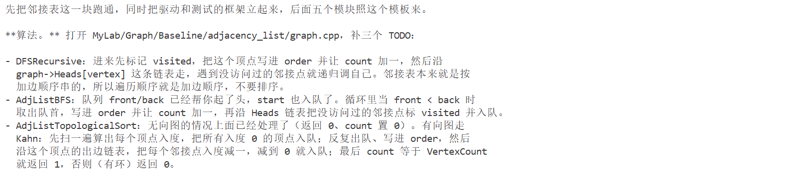

**智能体回应。** 三个函数按约定实现，五个用例全部 PASS（有向 DAG、有向环、无向图调拓扑、不连通、单顶点），编译零警告。`check.py` 按「跑驱动 + 逐行比对」实现；它还做了反向验证：改错一行能报 `MISMATCH` 并返回 1，给正确输出加行尾空格和末尾空行仍返回 0。

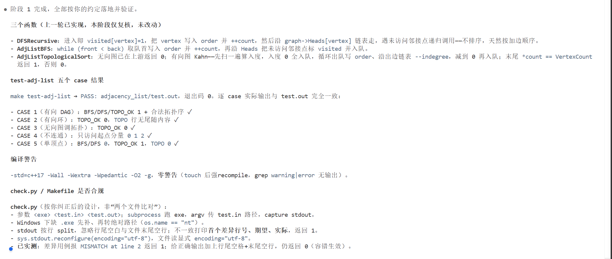

**我的判断。** 接受。这一段的价值不只是三个函数，而是把测试基础设施立住了；后面五个模块的 prompt 都能写得很短，因为驱动和比对脚本已经有模板。它主动报告「上一轮已实现、本阶段仅复核」，我据此把后续阶段定位成复核而不是重写。

#### 5.3 阶段 2 · 邻接矩阵：BFS / DFS / 拓扑

**Prompt 设计。** 这一段的重点不是再写一遍三个算法，而是防止它照抄邻接表。prompt 明确要求：扫描邻接点改成按编号升序扫矩阵行；跑完后回答「矩阵版和邻接表版在哪些 case 上输出不同、为什么」。如果它只报 PASS 不解释差异，说明它没有真正理解表示法的影响。

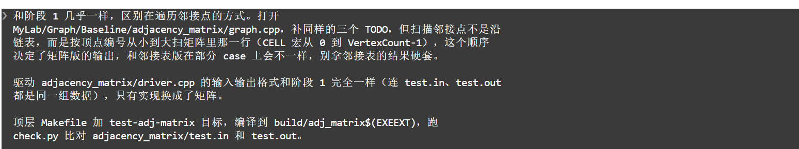

**智能体回应。** 五个用例全部 PASS，并主动构造了「加边顺序与编号顺序不一致」的最小反例，给出两种表示在 BFS、DFS、TOPO 上的分叉表，根因归结为枚举顺序。这个反例后来直接放进了报告的 3.1 节。

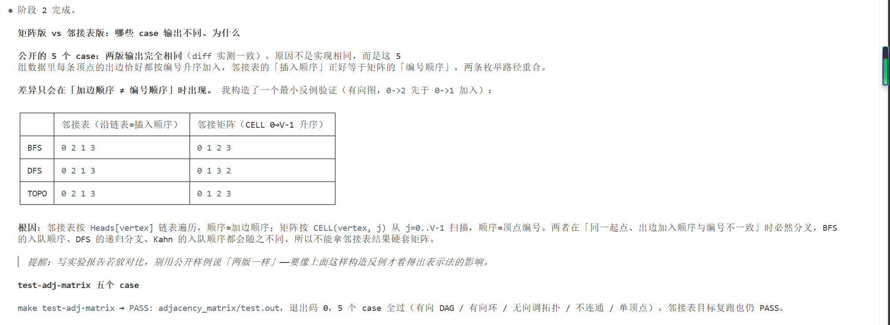

**我的判断。** 接受，并且认为这是六个阶段里最有价值的一次回应。它没有停在「测试通过」，而是解释了「为什么公开样例看起来一样、什么情况下会不一样」。这种反例比再写十个 PASS 更能说明它理解了实现。

#### 5.4 阶段 3 · 无权最短路

**Prompt 设计。** 这一段只补 `ShortestPath`，要求 `dist[]` 兼作访问标记，第一次遇到 `dist[next] == -1` 时设置距离和前驱。prompt 里没有重复 BFS 的定义，而是把「首次访问即最短」这个前提和 -1 的约定写清楚，让它专注在边界和输出上。

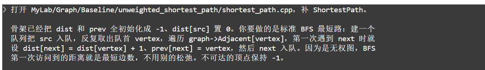

**智能体回应。** 三个用例全部 PASS，覆盖有向图、无向图、不可达点、单顶点；队列用预分配数组 + `front` / `back`，入队前用 `dist[next] == -1` 判首次访问；不可达点保持 -1；编译零警告。

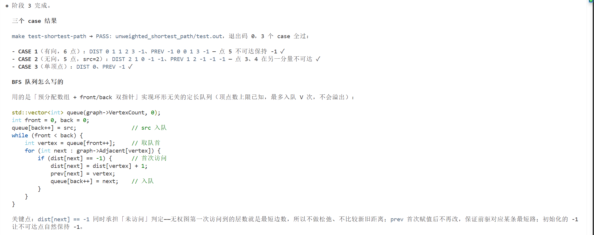

**我的判断。** 接受。这一段没有出现返工，说明前面把「-1 兼作未访问」的约定写进 prompt 是有效的；如果留给它自己选，很可能另加一个 `visited` 数组，和题面的 `dist` / `prev` 约定不一致。

#### 5.5 阶段 4 · Dijkstra

**Prompt 设计。** 这一段有两个明确要求：选点用线性扫描，不引入堆；除了比对 `test.out`，再写一个独立校验，检查 `dist` 和 `prev` 是否自洽。前者是为了贴合骨架的写法，后者是为了防止「数字碰巧相等但前驱链是错的」。

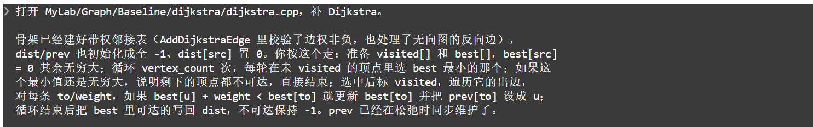

**智能体回应。** 三个用例全部 PASS；用 `visited[]` + `best[]` 线性选点；写了独立校验，检查每个可达点满足 `dist[v] == dist[prev[v]] + w` 且沿 `prev` 能回到起点；解释了为什么不用堆：接口和骨架更匹配，且堆要处理延迟删除。

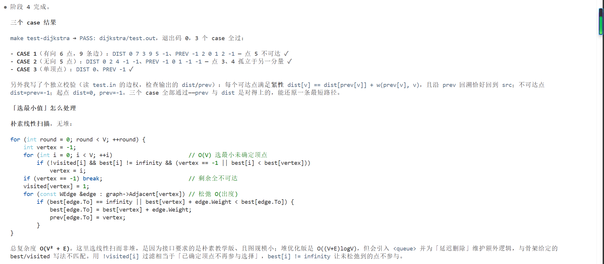

**我的判断。** 接受。独立校验这一条是我在 prompt 里主动加的，它把「输出对了」提升到「路径真的能还原」，这也是我在报告 3.3 节保留这个细节的原因。

#### 5.6 阶段 5 · Prim

**Prompt 设计。** Prim 的关键是确定性：同权边怎么选、松弛时等权要不要覆盖。prompt 里直接要求「编号升序 + 严格小于」，并让它回答「选顶点的循环怎么保证确定」。这样它不能只报 PASS，必须把规则说清楚。

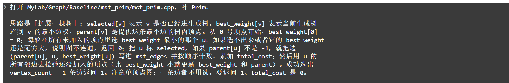

**智能体回应。** 四个用例全部 PASS（连通、等权、不连通、单顶点）；选点用编号升序 + 严格小于，同权保留编号更小的顶点；松弛同样用严格小于，父边唯一；单顶点返回 1、总权重 0。编译零警告。

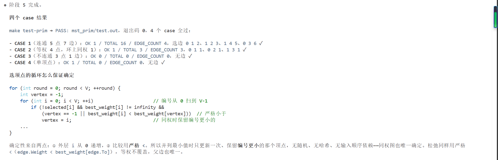

**我的判断。** 接受。它把确定性的两个来源（外层 `i` 递增、比较用严格小于）讲清楚了，这比只贴一段代码更有说服力。

#### 5.7 阶段 6 · Kruskal

**Prompt 设计。** 这一段要求补 `Find` / `Union` 和主循环，并明确路径压缩、按秩合并、非法顶点返回 0、单顶点返回 1。prompt 里没有重复并查集的原理，而是把「什么时候返回 false」「选满 V−1 条就停」这些行为约定写死。


**智能体回应。** 五个用例全部 PASS，包括非法顶点编号返回 0；`Find` 递归路径压缩，`Union` 按 rank 合并；主循环选满 V−1 条立即返回 1，循环外统一兜住不连通和单顶点。

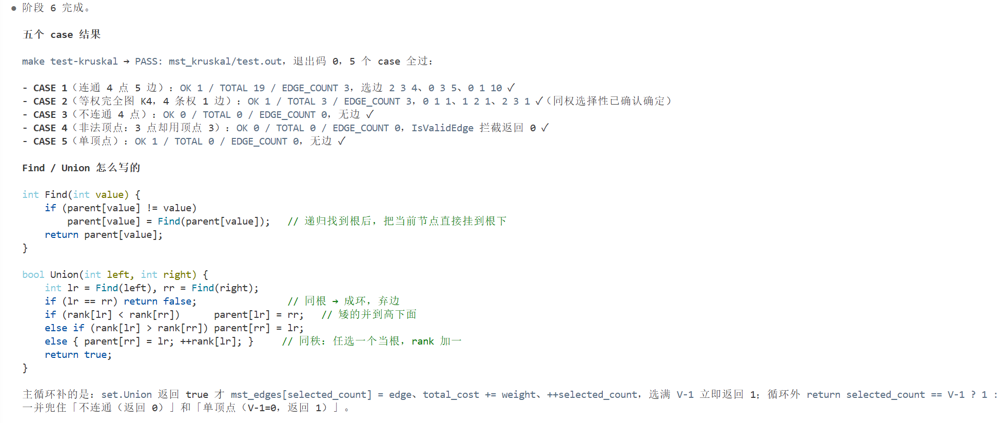

**我的判断。** 接受。唯一需要补充的是同权边的排序稳定性：`std::sort` 不保证稳定，同一构建环境下能复现，但跨实现可能选出另一棵合法的 MST。这一条它没有主动提，是我在写报告时补上的，放在 3.4 节。

#### 5.8 阶段 7 · 收尾整合

阶段 7 没有保留截图。这一段 prompt 的重点不是写功能，而是列验收清单：顶层 `make test` 依次跑六个目标、任一失败立即停止；`make clean` 用 `shutil.rmtree`；补 `.gitignore` 和交付 README；连跑两次 `make` 第二次不重新编译；全仓零警告；`.hpp` 与题面一致；没有绝对路径和构建残留。

智能体按清单逐项执行，六个目标全部 PASS，零警告，接口 diff 一致，没有残留。验收时还暴露了 360 误报 `adj_matrix.exe` 的问题，处理过程写在 4.4 节。这一阶段没有新算法，但它是把「六个模块各自能跑」变成「一个交付目录能一键跑」的关键。

---

### 六、复杂度与总结

| 模块 | 算法 | 时间 | 空间 |
| --- | --- | --- | --- |
| 邻接表 | BFS / DFS | O(V + E) | O(V + E) |
| 邻接表 | Kahn 拓扑 | O(V + E) | O(V) |
| 邻接矩阵 | BFS / DFS | O(V²) | O(V²) |
| 邻接矩阵 | Kahn 拓扑 | O(V²) | O(V) |
| 无权最短路 | BFS | O(V + E) | O(V) |
| Dijkstra | 线性选点 + 松弛 | O(V² + E) | O(V) |
| Prim | 线性选点 + 松弛 | O(V² + E) | O(V) |
| Kruskal | 排序 + 并查集 | O(E log E) | O(E + V) |

这次实验的收获主要在工程侧，而不是算法侧：

**先定约束，再写代码。** 接口、目录、输出格式、跨平台命令，这些如果留到实现时再商量，六个模块会各写各的。把它们提前写进 prompt，验收就变成对照清单，而不是反复猜。

**测试是最好的 prompt。** 让智能体自己跑 `test.out`、自己报 PASS、自己做反向验证，比让它口头保证「已完成」可靠得多。`check.py` 的负向测试尤其有用：它证明测试本身能抓到错误，而不是永远返回 0。

**确定性要写死，不能靠默认。** Prim 的同权选点、Kruskal 的排序、BFS 的入队顺序，都会影响逐行比对的结果。规则写进 prompt、写进代码、再写进报告，三处一致，才不会出现「本机过、换台机器不过」。

**对智能体的结论保持怀疑。** 它说「已实现」，本地可能还是骨架；它说「测试通过」，可能只是没跑比对。每一次都要看磁盘上的文件、看实际输出、看 diff，这也是这次验收一开始就发现代码没同步的原因。

---

### 七、运行说明

交付目录结构：

```text
24325083_甘锦珊_GraphBL/
├── Makefile
├── .gitignore
├── code/
│   ├── check.py
│   ├── edge.hpp
│   └── 六个模块目录/
└── 24325083_甘锦珊_实验报告.docx
```

六个模块目录结构相同，各自包含头文件、实现文件、测试驱动和一组公开样例：

| 模块目录 | 头文件 / 实现文件 |
| --- | --- |
| `adjacency_list/` | `graph.hpp` / `graph.cpp` |
| `adjacency_matrix/` | `graph.hpp` / `graph.cpp` |
| `unweighted_shortest_path/` | `shortest_path.hpp` / `shortest_path.cpp` |
| `dijkstra/` | `dijkstra.hpp` / `dijkstra.cpp` |
| `mst_prim/` | `mst_prim.hpp` / `mst_prim.cpp` |
| `mst_kruskal/` | `mst_kruskal.hpp` / `mst_kruskal.cpp` |

每个模块目录下还有 `driver.cpp`、`test.in`、`test.out`。

在交付目录下：

```bash
make                 # 编译六个驱动到 build/
make test            # 依次跑六个模块，任一失败立即停止
make test-adj-list   # 单独跑某一个模块（其余目标同理）
make clean           # 删除 build/
```

单独运行某个驱动：

```bash
./build/adj_list code/adjacency_list/test.in
```

Windows 下 MinGW 常把 GNU make 装成 `mingw32-make.exe`，把上面的 `make` 换成 `mingw32-make` 即可；想继续用 `make`，可以在 PowerShell 里执行 `Set-Alias make mingw32-make`。Windows 分支的链接参数是 `-static -s`：静态链接避免目标机缺少运行库，strip 减小体积，也能降低被杀毒软件误报的概率。

如果某个可执行文件仍被杀毒软件隔离（本机曾遇到 360 隔离刚编译出的程序），把项目目录加入信任区即可；`build/` 是编译产物，不参与提交。
