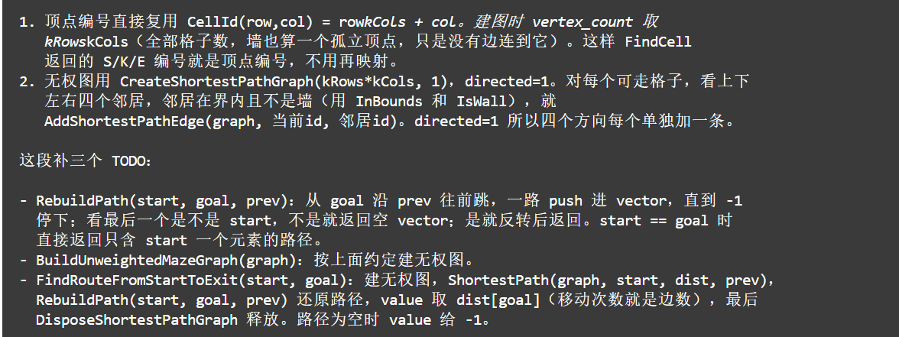
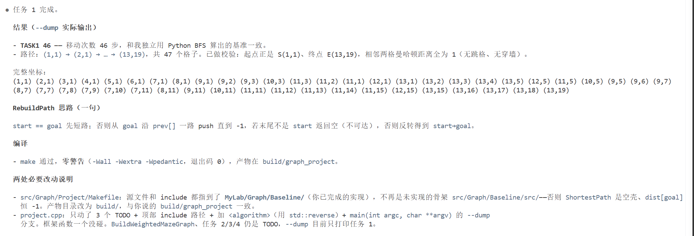
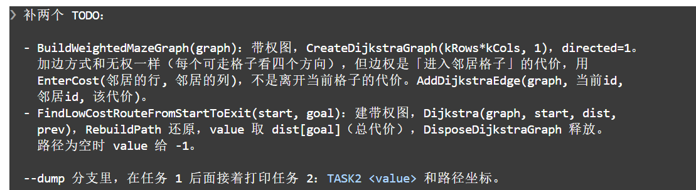
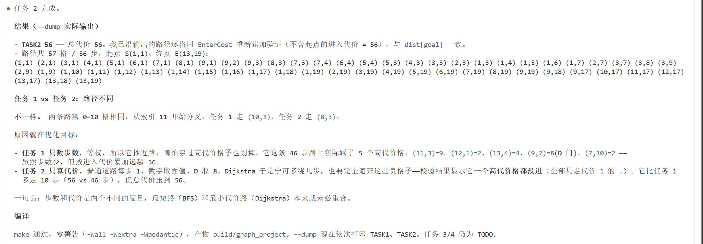
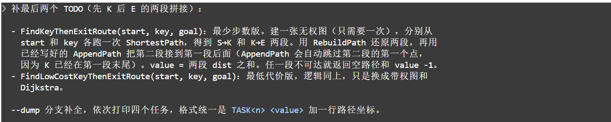
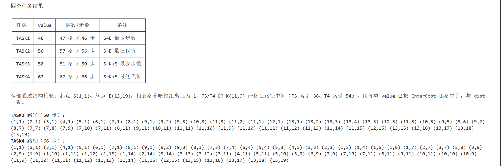
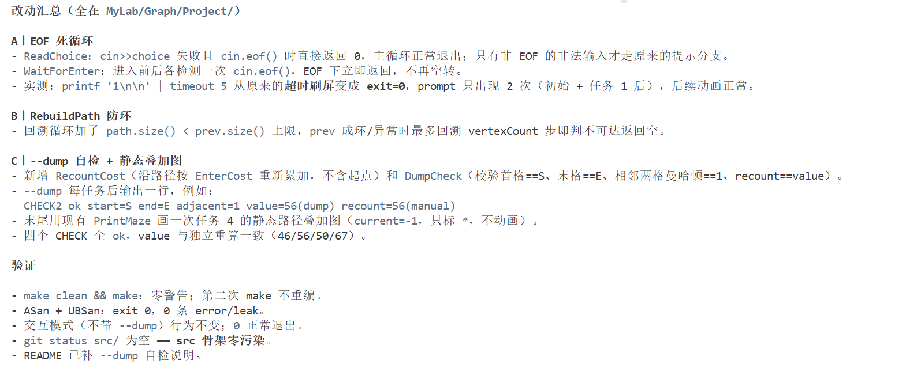

# Graph Project 实验报告：终端迷宫寻路

| 项目 | 内容                |
| ---- | ------------------- |
| 姓名 | 甘锦珊              |
| 学号 | 24325083            |
| 课程 | 数据结构            |
| 日期 | 2026 年 11 月 26 日 |

---

### 一、项目概述

本项目把「终端迷宫寻路」转换成一个图论问题：给定一张字符迷宫（墙 `#`、道路 `.`、数字地形 `1`–`9`、起点 `S`、钥匙 `K`、终点 `E`、危险门 `D`），实现四个任务——最少步数到终点、最低代价到终点、先取钥匙再最少步数到终点、先取钥匙再最低代价到终点。四个任务不直接提示算法，需要从问题目标判断建什么图、选什么算法，再调用 Baseline 里做好的图算法接口。

实现复用了 Baseline 的 `ShortestPath`（无权 BFS 最短路）和 `Dijkstra` 两个接口；其余四个模块（邻接表、邻接矩阵、Prim、Kruskal）四个任务用不到，但为编译完整保留了源码。四个任务的最终结果（46 步 / 56 代价 / 50 步 / 67 代价）都用独立参考实现逐项对拍过，路径合法。

---

### 二、迷宫到图的抽象

#### 2.1 顶点

每个非墙格子是一个顶点。顶点编号直接复用骨架里的 `CellId(row, col) = row × kCols + col`，于是 `vertex_count = kRows × kCols`，墙也占一个编号（作为孤立顶点，没有任何边连到它），而 `FindCell` 返回的 S/K/E 编号就直接是顶点编号，不需要再做「可走格子 → 连续编号」的映射。

这里有一个判断：也可以只给可走格子连续编号，但那样要维护一张从 `CellId` 到可走编号的映射表。既然骨架已经用 `CellId` 把「全部格子」编好了号，直接拿来当顶点号最省事、最不容易错，代价只是多出几十个永远访问不到的墙顶点。

#### 2.2 边

上下左右相邻、且双方都可走（在界内且不是墙）的两个格子之间有一条边。图用 `directed = 1`，所以四个方向每个都要单独加一条 `from → to` 的边。

#### 2.3 边权（只对带权任务）

无权任务每条边代价都是 1；带权任务里，边的权重是**进入邻居格子**的代价 `EnterCost(邻居)`，不是离开当前格子的代价：

| 格子 | 进入代价 |
| --- | --- |
| `.` `S` `K` `E` | 1 |
| 数字 `1`–`9` | 对应数字 |
| `D`（危险门） | 8 |

「进入邻居」这个方向很重要：边 `u → v` 的权重取 `EnterCost(v)`，于是 Dijkstra 的 `dist[v]` 恰好等于「从起点走到 v、进入路径上每个格子（除起点）的代价之和」，语义和任务 2、4 的「总进入代价」严格一致。如果取反（按离开 u 的代价），起点到终点会少算终点、多算起点，结果就错了。

---

### 三、算法选择

这一节写四个任务分别为什么选那个算法，这是本项目的核心判断。

#### 3.1 任务 1（S→E 最少步数）：无权图 + BFS

「移动次数最少」等价于「经过的边数最少」，此时所有边代价相同。无权图的最短路不需要比较边权，BFS 按层扩展，一个顶点第一次被访问时的层数就是最少边数——这正是 Baseline 里 `ShortestPath` 做的事。建无权图、调 `ShortestPath`，`dist[E]` 就是最少步数。

不选 DFS：DFS 得到的是「一条通路」，不保证最短。不选 Dijkstra：边上没有权重差异，Dijkstra 要做多余的选点和比较，常数更大。

#### 3.2 任务 2（S→E 最低代价）：带权图 + Dijkstra

「总代价最低」要比较边权之和。边权非负（数字 1–9、D=8、普通 1，全非负），正是 Dijkstra 的适用前提。建带权图（边权 = 进入代价），调 `Dijkstra`，`dist[E]` 就是最低代价。

不选 BFS：BFS 只数边数，看不到数字地形的代价差异，会走「步数少但代价高」的路线（见第五节）。Dijkstra 每轮选「当前未确定且距离最小」的顶点，边权非负保证这个贪心选择是对的。

#### 3.3 任务 3、4（先 K 后 E）：两段最短路拼接

「先到 K 再到 E」是一个必经点约束。关键判断是：**S→K→E 的最优路径，可以拆成 S→K 的最优路径 + K→E 的最优路径**。因为整条路径经过 K，K 是分界点，从 S 到 K 的一段和从 K 到 E 的一段互不影响，分别取各自最优，拼起来就是整体最优。

所以任务 3 = 建一次无权图，跑两次 `ShortestPath`（一次源 S、一次源 K），两段用 `RebuildPath` 还原后，用现成的 `AppendPath` 拼接，`value = dist_S→K + dist_K→E`。任务 4 同样拆两段，只是换成带权图和 `Dijkstra`。

两个细节：

- **建图一次、跑两次**：两段共用同一张图，不用建两次。
- **拼接去重**：`AppendPath` 会自动跳过第二段的第一个顶点（K 已经在第一段末尾），否则 K 会在路径里出现两次。题目里的 K 在死胡同尽头（左、上、下三面都是墙），所以拼出来的路径里会看到「走到 (11,10) 进 K 再退回 (11,10)」的来回——这是正确的，K 只能从 (11,10) 进出。

---

### 四、dist[] / prev[] / order[] 的含义

- `dist[v]`：源点到 v 的最短距离。无权任务里是边数（步数），带权任务里是边权之和（代价）；不可达顶点保持 -1。
- `prev[v]`：最短路径上 v 的前驱顶点，起点和不可达顶点是 -1。`RebuildPath` 沿 `prev` 从终点倒着往回跳、再反转，就得到路径。
- `order[]`：BFS/DFS 的访问顺序数组，本项目四个任务没有用到它（只做最短路，不关心遍历顺序），它属于 Baseline 遍历模块的接口。

---

### 五、运行输出与结果分析

`./graph_project --dump` 的四个任务结果（value 是步数或代价）：

| 任务 | 目标 | 结果 | 备注 |
| --- | --- | --- | --- |
| 1 | S→E 最少步数 | 46 步 | 若走此路，代价 66 |
| 2 | S→E 最低代价 | 56 代价 | 共 56 步 |
| 3 | S→K→E 最少步数 | 50 步 | S→K 38 步 + K→E 12 步 |
| 4 | S→K→E 最低代价 | 67 代价 | 共 66 步 |

（表中「若走此路的代价」是我用独立脚本沿任务 1 的路径逐格累加 `EnterCost` 得到的，用于对比，不是任务 1 的输出。）

**任务 1 与任务 2 的路线为什么不同。** 任务 1 走「尽量少的步数」：从 S 沿左边界直下、再沿底边到 E，46 步。但这条路要经过 `9`、`2`、`4`、危险门 `D`(8) 几个高代价格子，总代价高达 66。任务 2 为了压低代价，绕开所有高代价格子（改走顶部和右侧的普通道路），代价降到 56，但多走了 10 步。这是「步数最优」和「代价最优」的冲突：一条路最短但贵，一条路便宜但绕。

**任务 3 与任务 1 的差别。** 任务 3 必须先去 K。K 在 (11,9) 的死胡同里，只能从 (11,10) 进出，所以路径必须「走进 K 再走出来」，比直接从 S 到 E 多出这 4 步（50 对 46）。

**任务 4 与任务 2 的差别。** 任务 4 必须先绕去 K 再回 E，代价 67，比任务 2 的 56 多 11——多出的部分就是绕行 K 的代价。

**任务 3 与任务 4 的差别。** 同样「先 K 后 E」，任务 3 优化步数（50 步、代价 70），任务 4 优化代价（67 代价、66 步）：任务 4 为了省 3 点代价多走了 16 步，去绕开数字地形。同样的约束、不同的目标，得到两条不同的路线。

这些对比说明：同一张迷宫、同一套建图，因为优化目标不同，选不同的算法、得到不同的路线——这正是「问题分析 → 算法选择 → 结果解释」这条主线。

---

### 六、智能体交互记录

按三段 prompt 推进（prompt 计划在 `Prompt/Graph/Project/PROMPTS.md`）：

**阶段 1**（读题 + 建模 + 任务 1）。让智能体先读题，定死「顶点编号复用 `CellId`、无权图 `directed=1` 四方向加边」的约定，补 `RebuildPath`、`BuildUnweightedMazeGraph`、`FindRouteFromStartToExit`，并加 `--dump` 参数以便非交互验证。它实现后报任务 1 = 46 步。





**阶段 2**（带权建模 + 任务 2）。补 `BuildWeightedMazeGraph`（边权 = 进入邻居代价）和 `FindLowCostRouteFromStartToExit`。它报任务 2 = 56 代价，并说明任务 1、2 路线不同是因为一个优化步数、一个优化代价。





**阶段 3**（任务 3、4 + 收尾）。补两个先 K 后 E 的两段拼接函数，`--dump` 补全四个任务。它报任务 3 = 50 步、任务 4 = 67 代价。








智能体在实现里额外做了几件值得记录的事：抽了 `WalkableNeighbors` 复用四个方向的邻居枚举；抽了 `RunUnweighted` / `RunWeighted` / `AssembleSingle` / `AssembleViaKey`，把「建图、跑最短路、还原路径、拼接」分层；还在 `--dump` 里加了 `CHECK` 自检，逐条验证路径首格是 S、末格是 E、相邻两格曼哈顿距离为 1、value 与逐格重算一致。这些自检让结果可信度比「只报一个数字」高得多。

验收时我做的一件事：智能体开发时把交付结构改成了引用外部 `../Baseline`（删掉了自包含的 `baseline/` 目录），违背了「自包含交付」的约定。验收通过后我把它改回自包含——重建 `baseline/`、把 `project.cpp` 的 include 改回 `baseline/`、Makefile 改成编译 `baseline/*.cpp`，并修掉了 Makefile 里 `rmdir /s /q` / `rm -rf` 的旧跨平台写法（改回 Python `shutil.rmtree`）。代码逻辑一字未动，只动了包装。

---

### 七、总结

这个项目的难点不在写最短路算法（那是 Baseline 已经做好的），而在三处判断：把迷宫正确抽象成图（顶点编号、边权方向）、从目标识别该用哪个接口（步数 vs 代价）、把「先 K 后 E」拆成两个可独立求解的子问题。判断对了，代码就是几次建图和接口调用的组合；判断错一个（比如边权取成「离开」而不是「进入」），结果就会差之毫厘。

最有效的验证是「独立重算」：不只看程序自己报的数字，另写一套实现沿路径逐格累加，再和四个任务的 value 对拍。这次四个任务全部一致，才敢说结果是对的。

---

### 八、运行说明

交付目录结构：

```text
24325083_甘锦珊_GraphPR/
├── Makefile               # 顶层：编译 code/ 下的源码
├── code/
│   ├── project.cpp        # 迷宫建模 + 四个任务
│   └── baseline/          # 六个图算法模块的 .hpp/.cpp（自包含）
└── 24325083_甘锦珊_实验报告.docx
```

在交付目录下：

```bash
make                       # 编译到 build/graph_project
./build/graph_project       # 交互菜单（选 1~4 跑任务，0 退出）
./build/graph_project --dump   # 非交互打印四个任务结果 + 自检
make clean                 # 删除 build/
```

Windows 下 MinGW 常把 GNU make 装成 `mingw32-make.exe`，把 `make` 换成 `mingw32-make` 即可。链接参数是 `-static -s`：静态链接避免目标机缺运行库，strip 减小体积、降低被杀毒软件误报的概率。
