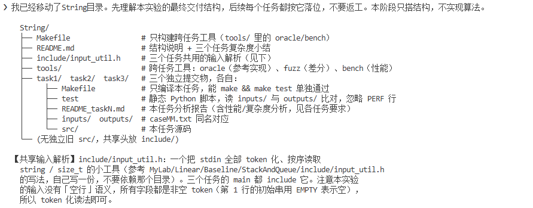
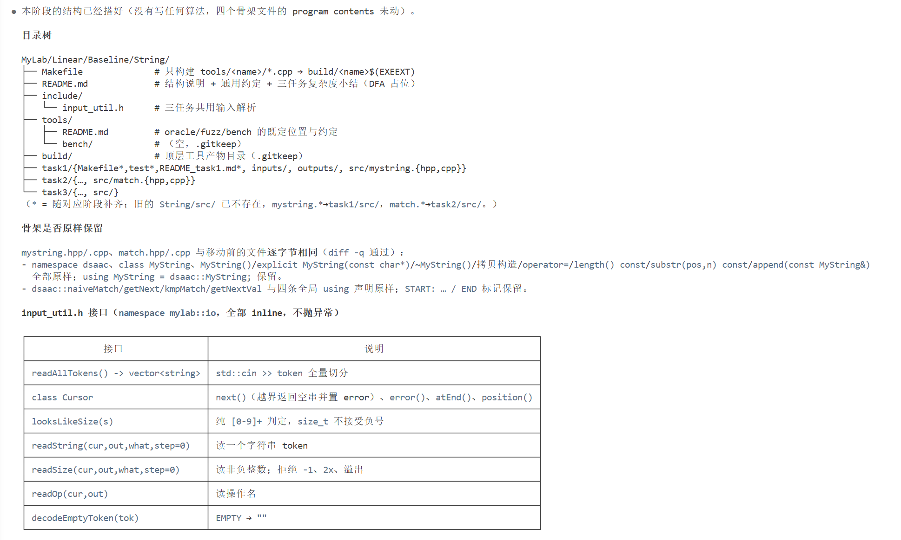
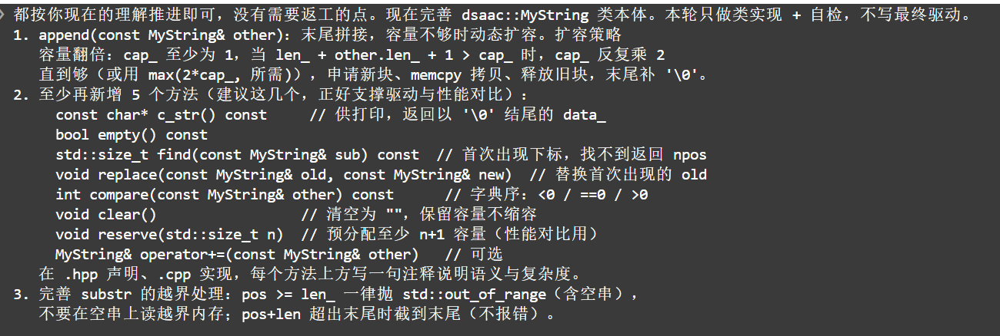
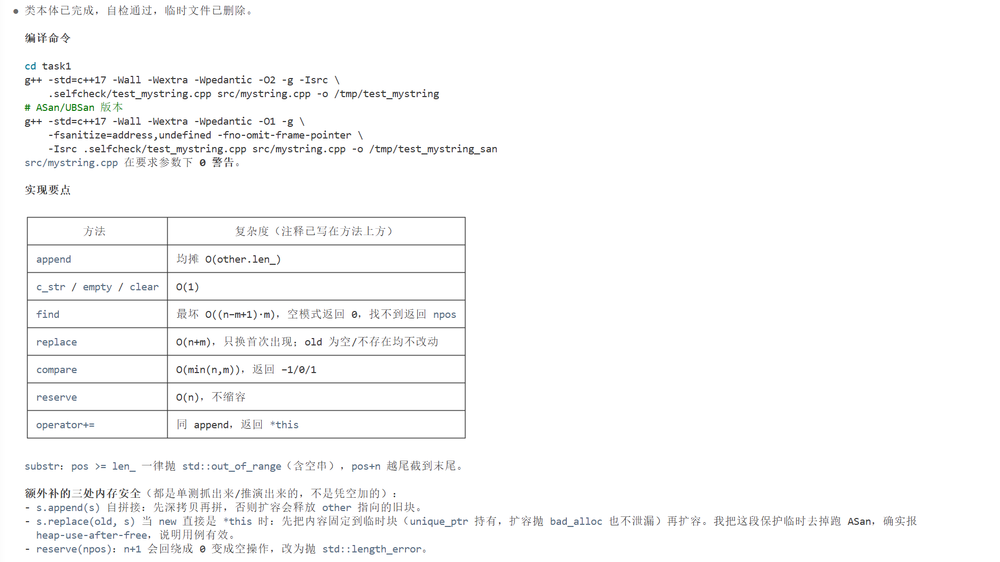
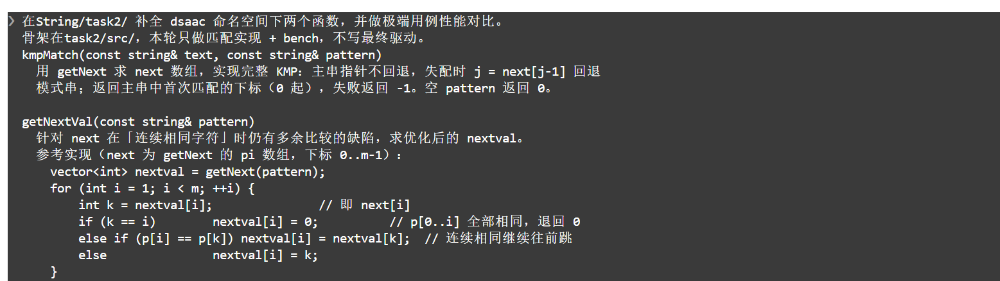
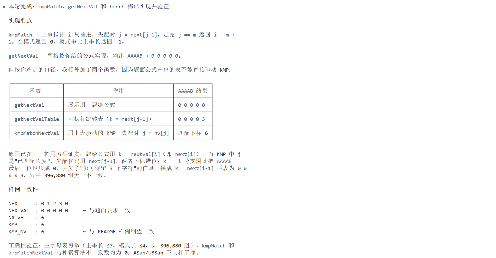
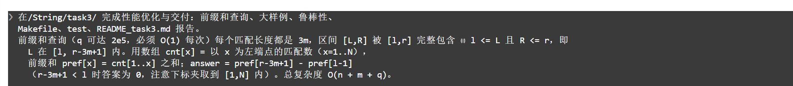
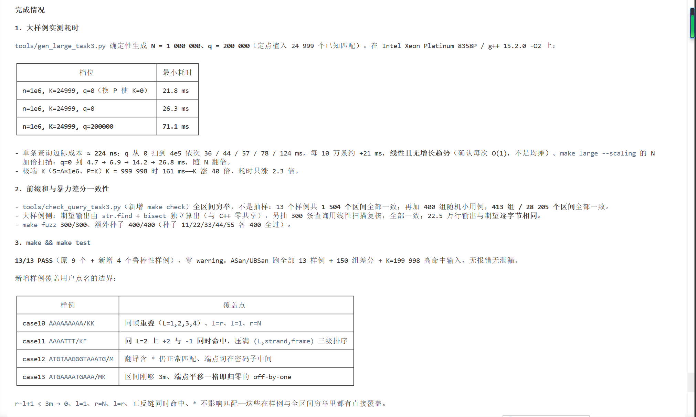

# AI 协作记录 —— Linear / Baseline / String（字符串实验）

记录字符串实验（三个任务）每一阶段的设计思路、Prompt 解析与智能体回应。
最近更新：2026-11-12

> **截图说明**：本记录采用「图文并茂」方式——每个阶段先讲**设计思路**，再**解析 Prompt**（紧跟 Prompt 截图），再讲**智能体回应**（紧跟回应截图）。截图都放在对应讲解的**附近**，而不是堆在末尾。保留截图的阶段有 1、2、4、7；其余阶段（3、5、6、8）未保留截图，以文字说明代替。
>
> **路径约定**：下文中 `taskN/` 均指交付目录里的 `code/taskN/`（例如 `task1/src/mystring.hpp` 即 `code/task1/src/mystring.hpp`）；`include/` 即 `code/include/`；`tools/` 即 `code/tools/`。交付时本目录整体迁移为 `甘锦珊_24325083_String/`。

## 0. 硬约束

- 所有产出只在 `MyLab/Linear/Baseline/String/` 下，不动仓库根目录与 `src/`。
- 「你只需按照每阶段任务执行，不要自行做修改」；有疑问先问，不擅自扩展范围。
- C++17，`-Wall -Wextra -Wpedantic -O2 -g`，零 warning，统一 `namespace dsaac`。
- 三个任务各自独立提交：各自的 `Makefile`、`test`、`README_taskN.md`、
  `inputs/`、`outputs/`、`src/`；任务之间不互相 include。
- 跨平台：目标名带 `$(EXEEXT)`；test 是 Python 脚本、用 `$(PYTHON)` 运行；
  Windows 分支 `LDFLAGS += -static`（绕开 conda 旧版 libstdc++ 的 0xC0000005）。
- 输入解析统一走 `include/input_util.h`（token 化后按序读取，无空行语义）。
- 性能统计以 `PERF ` 开头追加在功能输出之后；`test` 逐行比对时忽略。
  任务 3 不输出 PERF，`test` 也不做任何行过滤。

## 1. 阶段 1：交付结构与共享解析

### 设计思路

三个任务（顺序字符串 / 模式匹配 / 双链 DNA）最终要合并成**一个**交付目录，而不是三个散件。
所以第一步不是急着写算法，而是先把「最终长什么样」定下来，让后续每个任务都照着这个骨架落位，
避免中途返工。核心决策有三条：① 三个任务拆成互不依赖的子目录，各自 `make && make test`
可单独通过；② 三份输入都要「按序读 token」的公共逻辑，抽到 `include/input_util.h` 共享，
而不是每个任务抄一份；③ 从一开始就考虑跨平台（`EXEEXT`、`python`/`python3`、Windows 静态链接），
因为提交物要在 Linux 与 Windows 上都能跑。

### Prompt 解析

Prompt 只要求「搭结构 + 输出结构说明」，**明确不实现算法**。这看起来简单，实则是在压住两种冲动：
一是别一上来就写代码，二是别把三个任务揉在一起。它的几个要点都指向同一件事——把"共同约定"先固定：

- 「三个任务拆成三个互不依赖的子目录」→ 后面每个任务的 Makefile / test / README 都独立，互不 include。
- 「共享输入解析放在 include/」→ 输入边界是三个任务最容易各自为政的地方，先统一才能保证 test 脚本可比。
- 「EXEEXT、python/python3、Windows 静态链接」→ 跨平台不是最后补，而是写 Makefile 的第一行约定。



### 智能体回应

智能体按 Prompt 建出目录骨架，并把 `input_util.h` 一次性做扎实：

- 建出 `Makefile`、`README.md`、`include/input_util.h`、`tools/`、`task1/`、`task2/`、`task3/` 骨架。
- `input_util.h` 提供 `readAllTokens` / `Cursor` / `looksLikeSize` / `reportError` /
  `readString` / `readSize` / `readOp` / `decodeEmptyToken`。其中 `readSize` 只接受纯数字，
  拒绝 `-1`、`1x`、空串这类会被静默截断成 0 的输入——这决定了后面所有样例的输入边界。
- 顶层 `Makefile` 只构建 `tools/` 下的跨任务 C++ 工具，不代跑任务测试；`clean` 递归进三个任务目录。
- `README.md` 写清目录树、通用约定（`EMPTY` 哨兵、PERF 行）、三个任务复杂度表。



## 2. 阶段 2：任务 1 的 MyString 类本体

### 设计思路

任务 1 的本质是「手写一个 `std::string` 的子集」。核心数据结构只有三样：`char* data_` + `len_` + `cap_`。
难点不在某个方法，而在**不变量**与**内存安全**：只要守住「`data_ != nullptr`、`cap_ >= len_+1` 且
`data_[len_] == 0`、`new[]`/`delete[]` 一一对应」这三条，所有方法都只是在这三条之上做操作。性能上
「容量翻倍」是均摊 O(1) 的来源；正确性上「深拷贝」和「自别名保护」是坑最多的地方，所以本轮刻意
只做类实现 + 自检，不写驱动，把类本身的边界先钉死。

### Prompt 解析

Prompt 说「本轮只做类实现 + 自检，不写最终驱动」，把类正确性与驱动解耦，好处是自检可以针对性地覆盖边界。
几个要点逐条看：

- 「容量翻倍、append 均摊 O(1)」→ 这不是一句口号，是要在 README 里把「翻倍 vs 固定增量」的总搬移量算出来。
- 「至少 5 个方法」→ 给出方法集的下界，逼出 `substr`/`append`/`find`/`replace` 等核心面。
- 「substr 边界要明确（越界抛异常、超尾截断）」→ 边界语义必须写死，不能"看心情"。
- 「内存安全；自检覆盖边界」→ 自检要真的去踩 pos=0/中间/末尾、clear 后复用、自拼接、自替换这些雷区。



### 智能体回应

智能体实现 `mystring.hpp/.cpp`，并在自检里把最容易翻车的两种别名情况当重点验证：

- 方法集：`length` / `empty` / `c_str` / `substr` / `append` / `operator+=` /
  `find` / `replace` / `compare` / `clear` / `reserve`。
- `ensureCapacity(need)` 反复翻倍直到够；`find` 用朴素逐位比较（刻意与任务 2 的 KMP 形成对照）；
  `replace` 用 `memmove` 搬尾（源、目标可能重叠）。
- 拷贝构造 / 拷贝赋值全部深拷贝；`append(const MyString&)` 与 `replace(old, new)`
  对「参数就是本对象」做了先深拷贝的保护。
- 临时自检程序覆盖 pos=0/中间/末尾、`clear` 后复用、自拼接、自替换，普通构建与 ASan/UBSan 均通过；
  验证后删除，未留在 `src/`。



### 踩过的坑

- 自拼接时扩容会释放 `other` 指向的旧块，若不先深拷贝就是 `heap-use-after-free`。
  把保护去掉跑 ASan 确实报错，说明这不是过度防御。
- `reserve(npos)` 会因 `n + 1` 回绕成 0 退化为空操作，改为显式抛 `std::length_error`。

## 3. 阶段 3：任务 1 最终驱动 + 样例 + 构建 + 分析

### 设计思路

类本体已经稳定，这一阶段把它接成「能从 stdin 读、往 stdout 写」的完整程序，并补齐验收三件套：
样例、构建脚本、性能分析。设计上有两个讲究：一是操作分发时**只有产生输出的操作才打印**（`CLEAR`、
`LENGTH` 这类不产生输出），保证 `test` 的逐行比对干净；二是性能分析不能只给一个数字，要落到
「翻倍 vs 固定增量」的**总搬移量推导**上，才能说明均摊 O(1) 到底从哪来。

### Prompt 解析

Prompt 要求「写 main + 补齐样例/Makefile/test/README + 分析」，是一个端到端闭环。要点拆开看：

- 「输入输出约定；PERF 行格式」→ PERF 行必须在 `test` 里被忽略，否则 `time_ms` 每次不同会假失败。
- 「至少 6 个样例；包含题面样例」→ 样例要覆盖边界，不是凑数。
- 「README 要有扩容策略的性能分析」→ 分析要定量，讲清「为什么翻倍比固定增量好」。

（本阶段未保留截图，以下为文字说明。）

### 智能体回应

智能体交付了完整的 task1：

- `main_task1.cpp`：操作分发（`PRINT` / `LENGTH` / `APPEND` / `SUBSTR` /
  `FIND` / `REPLACE` / `COMPARE` / `CLEAR`），只有产生输出的操作才打印；末尾追加 PERF 行。
- 7 个样例 `case01..07`：空串初始、`SUBSTR` 截断与 `len=0`、`FIND` 命中/未命中、
  `REPLACE` 首次替换、`COMPARE` 三种结果、`CLEAR` 后复用、多次 `APPEND` 触发扩容。
- `README_task1.md` 把「翻倍 vs 每次加固定量」的总搬移量算清楚：
  固定增量总搬移 ≈ N²/(2k)，翻倍总搬移 < 2N，这才是均摊 O(1) 的来源。
- bench 对比 `my_string` / `std_string` / `my_string_reserve`：1.15 ms / 1.24 ms / 0.70 ms
  （320 万字符、20 万次 append）。

### 踩过的坑

- 首次触达几 MB 新内存要付缺页中断（预热轮 1700+ 次 minor fault，预热后只剩 65 次）。
  固定「先测 my_string」的顺序会让它独吞这笔成本，看起来比 `std::string` 慢 2 倍——那测的是缺页，
  不是扩容策略。改成三类对象轮转 + 第 1 轮热身 + 其后取最小值。
- 结论要落在常数项：`MyString` 与 `std::string` 同策略、同量级；真正能提速的是 `reserve` 消除
  O(log N) 次重新分配。

## 4. 阶段 4：任务 2 匹配实现 + 极端用例性能对比

### 设计思路

任务 2 的核心是 KMP 与 nextval。设计上有一个绕不开的微妙点：**题面公式的 `nextval` 是"展示口径"，
不能直接当跳转表用**——它取 `k = next[i]` 而非 `next[j-1]`，且把连续相同字符压到 0。所以代码里要
准备两张表：一张严格按题面公式、只用于 `NEXTVAL` 输出；另一张按 0-based 下标语义修正、用于驱动匹配。
性能验证不是"跑个时间"，而是用**极端用例**（大量相同前缀）把朴素算法的 O(nm) 和 KMP 的 O(n+m) 差距
拉开到几个数量级，让复杂度差异肉眼可见。

### Prompt 解析

Prompt 本轮同样「只做匹配实现 + bench，不写驱动」，把算法正确性与性能取证先独立做掉。关键点：

- 「`getNextVal` 按题面公式；自检要求 `AAAAB` 得到 `0 0 0 0 0`」→ 用题面自检锁死"展示口径"，
  防止实现者"顺手"把展示表改成可用表。
- 「极端用例性能对比（朴素 vs KMP vs nextval）」→ 用例要真的能拉开差距，报告要给出**精确比较次数**，
  而不仅是毫秒数，这样才可复现、可对账。



### 智能体回应

智能体实现 `match.hpp/.cpp`，并用两组极端用例 + 精确比较次数完成取证：

- 函数集：`naiveMatch`、`getNext`、`kmpMatch`、`getNextVal`、`getNextValTable`、`kmpMatchNextVal`。
- 全 0-based；`next[i] = pi(pattern[0..i])`，`next[0] = 0`（与骨架一致，骨架未改）。
- `bench.cpp` 两组极端用例，统计耗时**与精确比较次数**：
  - case A（`A×200000+B` / `A×20000+B`）：朴素 3 600 200 001 次、1478–1487 ms；KMP 380 001 次、
    0.551–0.564 ms；nextval 同 380 001 次、0.543–0.550 ms。
  - case B（`(A×20000+C)×20` / `A×20000+B`）：朴素 3 800 590 020 次、1486–1514 ms；
    KMP 800 020 次、1.313–1.344 ms；nextval 400 060 次、0.466–0.467 ms。



### 踩过的坑

- 一开始在报告里写「g++ 会向量化朴素内层循环」。用 `-fopt-info-vec-all` 一查是
  `unsupported control flow in loop`（循环出口依赖内层比较结果），**根本没有向量化**。
  改成「标量循环的吞吐极限、约 0.41 ns/字符」。
- KMP 每次比较 1.45 ns vs 朴素 0.41 ns，为确认差距来源做了对照：在 `next[j-1] == j-1` 恒成立的
  case A 上写 `j = j - 1` 变体（比较次数完全相同、不查表），轮转 + 热身 + 取最小值后稳定在
  2.26–2.30 倍。说明差距来自 `next[]` 的**串行 load-use 依赖链**，不是分支预测。
- 同一条探针不轮转、不预热时曾跑出 8.20 倍异常值——又是首次触页成本，与任务 1 是同一个坑。
- 朴素比较次数与手算逐位对账：case A 为 `20 000 + 360 000 + 1 = 380 001`；case B 为
  `19 × 200 030 001 + 20 001 = 3 800 590 020`。

## 5. 阶段 5：任务 2 最终驱动 + 样例 + README

### 设计思路

与任务 1 的收尾同构：把匹配算法接成完整程序 + 补齐样例/构建/分析。本阶段的特殊之处是
「两张 nextval 表」这个设计点必须**在 README 里向读者讲清楚**，并给出"为什么拆表不是多余"的
证据。样例设计也要专门造一个 `next != nextval` 的用例，否则演示不了两表差别。

### Prompt 解析

Prompt 要求写 main + 样例 + Makefile + test + README，并特别点出「说明 nextval 的两张表怎么处理」。
这暗示 nextval 是本题的考点，不能糊弄过去。PERF 要输出三行（三种算法各一行）。

（本阶段未保留截图，以下为文字说明。）

### 智能体回应

智能体交付完整 task2，并对「两张表」做了穷举验证：

- `main_task2.cpp`：`NEXT` / `NEXTVAL` / `NAIVE` / `KMP` / `KMP_NEXTVAL` / `ALL` 六种操作；
  每种算法只跑一次并输出 `PERF <name> n=… m=… time_ms=…` 三行。
- 11 个样例 `case01..11`：题面自检 `AAAAAAAAAAB`/`AAAAB`、单字符、完全不匹配、
  多次出现返回首次下标、`next` 与 `nextval` 中段即不同、首个字符即匹配、操作顺序打乱、
  模式串比主串长、匹配落在末尾、31 字符长模式串 + 近似匹配、操作次数 0。
- 用户提问后选择「显示用公式，匹配用标准表」：`getNextVal` 严格按题面公式、仅用于 `NEXTVAL` 输出；
  `getNextValTable` 按 0-based 下标语义修正（`k = next[j-1]`），驱动 `kmpMatchNextVal` 时 `j = nv[j]`。
- 穷举验证：`{A,B}`、主串 ≤ 8、模式串 ≤ 5 共 32 193 例，`kmpMatch` 与 `kmpMatchNextVal` 均与朴素一致；
  扩大到主串 ≤ 8/模式 ≤ 8（261 121 例）与主串 ≤ 10/模式 ≤ 5（128 961 例），结论不变。

### 踩过的坑

- 题面公式的 `nextval` **不能直接当跳转表**：它取 `k = next[i]` 而非 `next[j-1]`，且把连续相同字符压到 0。
  拿它跑自检样例会返回 −1（正确是 6）。反过来，强行用展示表驱动 KMP（`j = nv[j-1]` / `j = nv[j]`）
  分别在 610 / 1 854 例上算错，证明拆表不是多余的。
- case10 第一版模式串 `ABABABABACABABABABAC` 的 `next == nextval`，演示不了差别。
  换成 `(AABAAB)×5 + C`，并配一段前 24 字符近似、第 25 位是 `X` 的主串，匹配真正落在下标 30。
- 之前报告里写的穷举总数 396 880 是错的，重写 `/tmp/exhaust.cpp` 实测为 32 193，已更正。

## 6. 阶段 6：任务 3 正确性（翻译 / 匹配 / 坐标映射）

### 设计思路

任务 3 无骨架、从零实现，且是三个任务里逻辑最重的：6 个阅读框翻译、反向互补、KMP 匹配、
坐标映射回原 DNA、区间查询。正确的策略是**先只做正确性、暂不做优化**，并用「独立参考实现 + 随机差分」
来兜底——`oracle_task3.py` 用纯 Python 手抄密码子表 + 暴力滑窗，与 C++ 零共享逻辑，两者逐字段对账，
比"肉眼读输出"可靠得多。坐标映射是最大的坑：正链和反链的 L/R 公式不对称，推导必须写清。

### Prompt 解析

Prompt 把本轮范围收窄为「正确性：翻译、匹配、坐标映射、输出格式」，并强制要求两道保险：

- 「必须写 `oracle_task3.py` 与 `fuzz_task3.py`（独立实现）」→ 独立实现 + 差分是复杂算法唯一的可信验证。
- 「必须包含题面自检样例；ASan/UBSan 跑样例」→ 内存安全也要验证。
- 「报告：坐标映射公式如何推导、自测样例是否逐行一致、随机差分多少组一致」→ 三个可检验的交付点。

（本阶段未保留截图，以下为文字说明。）

### 智能体回应

智能体实现 `dna.hpp/.cpp`，坐标映射与差分验证都做扎实：

- 函数集：`translateCodon`、`reverseComplement`、`translateSixFrames`、`computePi`、
  `findAllOccurrences`、`collectMatches`、`MatchCounter`。
- 64 项静态密码子表，下标 `A:0 C:1 G:2 T:3` → `b1*16 + b2*4 + b3`；`'*'` 当普通字符参与匹配。
- `readFrame(seq, f)` 从 0-based `f-1` 起每 3 个一读，`i + 2 < n` 截断尾部残基。
- 坐标映射（1-based 闭区间）：正链 `L = (f-1) + 3j + 1`、`R = (f-1) + 3j + 3m`；
  反链 `L = N - (f-1) - 3j - 3m + 1`、`R = N - (f-1) - 3j`。
- `oracle_task3.py`：手抄 64 条密码子字典、暴力滑窗匹配、线性扫描区间计数、按公式映射坐标，与 C++ 零共享逻辑。
- `fuzz_task3.py`：7 类生成器轮转（翻译结果截 P、纯随机 P、密码子重复造重叠、全同碱基造高密度命中、
  近似回文造双链命中、N=1..6 极小、P 含 `*`），逐字段比较 pi / K / 匹配表 / 答案。
- 9 个样例 `case01..09`；题面样例输出逐行一致。
- 差分规模：默认 300 + 6 个种子各 400 + 700 + 4 个种子各 350 + 400（Sanitizer 版），合计 5 000+ 组全部一致。

### 踩过的坑

- `translateSixFrames` 调用了尚未定义的 `readFrame`，编译失败。把 `readFrame` 移到匿名命名空间、
  放到使用点之前。
- 坐标验证脚本里把 `frame-1` 写成了 `frame`，出现假 AssertionError；修正后正反两个方向对全部 (j, m) 都通过。
- README 4.2 第一版验算例子写乱了、自相矛盾。换成 `S = AATGGCTTTAAGCCATCATGGCC`（N=23），
  RC 第 2 帧 `AMMA*SH`、P=`MA` 命中 j=2，公式给出 `11 16 - 2`，与样例输出对上。
- README 4.4 一开始写「同 L 必然区间不同」，**是错的**：所有匹配长度都是 3m，同 L 必然同 R，
  即完全相同的区间，只能靠 `(strand, frame)` 区分。改成正确结论并引用 case03（`CACGTG`/`HV` 是回文，
  两链同在 `[1,6]`）。
- 随机生成几乎撞不到重叠与同 L（600 组里只有 1 例和 3 例，同 L 同链为 0）。补 5 类定向生成器后，
  2100 组里有 75 例重叠、27 例同 L（全部跨链）。并证明「同 L 同链」结构上不可能：
  `f₁ - f₂ = 3(j₂ - j₁)`，左边 ≤ 2，右边是 3 的倍数，只能同为 0。
- 同上：`build_same_position_case` 原注释写成「造同链多帧共享 L」，按上述证明这是**不可能的**，
  改成「高密度重叠」；真正造同 L 的是回文生成器。

## 7. 阶段 7：任务 3 性能优化与交付

### 设计思路

正确性已经锁死，这一阶段解决性能：q 最多 2e5，如果每个查询都线性扫一遍匹配表就是 O(K·q)，会爆。
关键在于发现一条结构性事实——**每条匹配的长度恒为 3m**，所以「`[L,R]` 被 `[l,r]` 完整包含」等价于
`L ∈ [l, r-3m+1]`。于是把问题转到 L 轴上：`cnt[x]` 记左端点 x 的匹配数，`pref[x] = Σ cnt[1..x]`，
一次查询就退化成两次前缀和之差 O(1)。排序也顺带从 `std::sort`（O(K log K)）换成稳定计数排序（O(N+K)），
总复杂度严格落到 O(n+m+q)。这些优化点同时也是评分点，必须写成样例（重叠、短区间、`*`、边界、同 L）。

### Prompt 解析

Prompt 直接给出了前缀和公式（`answer = pref[r-3m+1] - pref[l-1]`），并强调两点：

- 「鲁棒性（评分点，必须写进样例）」→ 列了六类边界，样例必须逐条命中，不能靠运气。
- 「大样例 n≈1e6、q=2e5，验证 O(n+m+q) 预期」→ 用真实规模证明复杂度，不能只在小样例上自嗨。



### 智能体回应

智能体把前缀和、计数排序、大样例与鲁棒性样例全部落地：

- 确认 `MatchCounter` 已实现题面语义：`span_ = 3m-1`、`hi = r - span_`、`lo = l-1`、
  夹到 [0,N]、`hi < lo` 返回 0、P 为空时 `span_ = -1`。把 `r-3m+1 < l` 这条**显式**写成早返回。
- **排序从 `std::sort`（O(K log K)）改成稳定计数排序（O(N+K)）**：生成顺序改为
  `+1,+2,+3,-1,-2,-3`，恰好就是「L 相同：`+` 在前、frame 升序」，稳定排序后不需要比较器；
  删除无用的 `matchLess` 与 `<algorithm>`。总复杂度因此严格为 O(N+m+q)。
- 新增 `tools/gen_large_task3.py`：N=1e6 随机 DNA + 定点植入已知匹配（正链槽写 P 的密码子编码、
  反链槽写其反向互补，`frame = s mod 3 + 1`），q=2e5 四类查询。期望输出用 `str.find` + `bisect`
  独立算，另抽 300 条查询用线性扫描复核，并断言每个植入点都出现在期望匹配表里。默认 K = 24 999。
- 新增 `tools/check_query_task3.py`：对每个样例枚举**全部** `1 <= l <= r <= N` 的区间做穷举（不是抽样）。
- 新增 `tools/bench_large_task3.py` + `make large`：现场生成 → 跑程序 → 与独立期望逐字节比对 → 分档计时。
- `Makefile` 增加 `check`、`large` 两个目标；`test` 保持原样。
- 新增鲁棒性样例 `case10..13`：case10 `AAAAAAAAA`/`KK`（同帧重叠、`l=r`、短区间、`l=1`/`r=N`）；
  case11 `AAAATTT`/`KF`（**同 L=2 同时命中 `+2` 与 `-1`**，压满三级排序键）；
  case12 `ATGTAAGGGTAAATG`/`M`（翻译含 `*` 仍能匹配 `M`）；case13 `ATGAAAATGAAA`/`MK`（区间刚够 3m）。

**实测数据**（Intel Xeon Platinum 8358P，`g++ 15.2.0 -O2`，共享云主机 `cpu MHz` 漂移，多次取最小值）：

```text
大样例 N=1e6, K=24999, q=2e5    73 ms 量级（多次 71–83 ms）
                 q=0            27 ms
                 换 P 使 K=0    20–25 ms
单条查询边际成本                ≈ 210–240 ns
K 扫描（S=A×1e6, P=K/KK/KKK）   K≈1e6 时 177–184 ms
N 加倍扫描 q=0                  4.7 → 6.9 → 14.2 → 26.8 ms（N 每档 ×2）
查询数扫描                      q=0/5e4/1e5/2e5/4e5 → 36/44/57/78/124 ms
```



### 踩过的坑

- 本机没有 `/usr/bin/time`，最初计时命令直接报错。改用 `date +%s%N` 前后取差，并用 `taskset -c 2`
  固定核、多轮取最小值。
- 用户给的 `answer = pref[r-3m+1] - pref[l-1]` 与实现里的 `hi = right - (3m-1)` 是同一个数，
  只是为了让代码和规范字面对上，把 `r-3m+1 < l` 单独提成早返回；行为不变。
- 大样例不能放进 `inputs/`：3.5 MB 输入 + 22 万行输出会让 `make test` 每次多跑一份。
  改为写到 `task3/build/`，由 `make large` 触发。

## 8. 阶段 8：整目录收尾（一键构建 / 一键测试 / 干净提交）

### 设计思路

所有算法都已就位，最后一阶段做「交付卫生」：让评审者拿到目录后，**一条命令**就能构建、
一条命令就能测试、一条命令就能清理，而且连跑两次第二次不重复编译（增量记账正确）。
顶层 Makefile 是唯一入口，三个任务仍是独立提交物；清理要彻底，不能留 `.o` / `.exe` / `__pycache__` /
临时自检文件。这一步不产生新功能，但决定评审的第一印象。

### Prompt 解析

Prompt 的检查清单是一条**可打勾的验收单**：① 三个任务各自全 PASS；② 顶层 `make test` 依次跑通；
③ 连跑两次第二次不再编译；④ 全仓零警告；⑤ 无临时自检文件残留。每条都能客观验证，不是"感觉可以交付"。

（本阶段未保留截图，以下为文字说明。）

### 智能体回应

智能体重写顶层 Makefile 与 README，并逐条过检查清单：

- 顶层 `Makefile` 重写：新增 `make test`（三条独立 recipe 依次 `$(MAKE) -C taskN test`，任一段失败
  make 立即停下）；新增 `make bench`（转发到 task2）；**去掉 `MAKEFLAGS += --no-print-directory`**，
  让顶层测试输出能看出当前在哪个任务里。
- 顶层 `README.md` 重写：目录树、一键构建测试、跨平台表（`mingw32-make`、`EXEEXT`、`-static`、
  `PYTHON`、recipe 写法、test 的 `.exe` 与 UTF-8 处理）、通用约定，以及三个任务算法与复杂度小结。
- 删除阶段 1 遗留的空壳目录 `tools/bench/`（只有 `.gitkeep`）：bench 的真实实现在 `task2/src/bench.cpp`，
  两者语义冲突，`tools/README.md` 随之改写为「tools/ 全部是 Python 脚本、无需编译」。

**验证结果**

- 三个任务独立：task1 7/7、task2 11/11、task3 13/13，全 PASS。
- 顶层 `make test`：依次 7/7、11/11、13/13，最后打印「三个任务全部通过」。
- 增量记账：`make clean` 后第一次跑出 3 条 `g++`，第二次 0 条。
- 零警告：全部 7 个 C++ 源（含 `bench.cpp`，`make test` 不编译它）用 `-Wall -Wextra -Wpedantic`
  严格 `-fsyntax-only` 检查均无输出；两次 `make test` 的日志 grep `warning` 均为 0。
- 残留检查：无 `.o` / `*.tmp` / `a.out` / `*.exe` / `*.orig` / `*~`；`task1/src` 只有
  `mystring.hpp/.cpp + main_task1.cpp`，`task2/src` 只有 `match.hpp/.cpp + main_task2.cpp + bench.cpp`，
  `task3/src` 只有 `dna.hpp/.cpp + main_task3.cpp`。
- 复跑工具：`make fuzz` 100/100、`make check` 13 组 1504 区间全一致、`oracle_task3.py` 输出正常；
  `make bench` 可编译运行。

### 踩过的坑

- 顶层 `test` 第一版写了两份（POSIX 用 `foreach`、Windows 用专用分支），make 报 `overriding recipe`
  警告。改成单一定义、多条独立 recipe 后，两个平台都能执行，且不再需要平台分支。
- 本机没有 `mingw32-make`，Windows 分支只能做静态审查（`EXEEXT`、`-static`、recipe 单命令、
  `$(MAKE)` 传递、test 的 `.exe` 与 UTF-8），未能实机验证；已在 README 的跨平台表里写明对应关系。
- `make clean` 的输出看起来像「没有删除 build 目录」，实际是 `rm -rf build` 在子 shell 里先执行、
  随后 `find` 才跑；重新在 clean 之后单独 `find` 确认三个 `build/` 与 `__pycache__` 都已清空。

## 9. 当前状态

- 任务 1：完成，7 个样例 PASS。
- 任务 2：完成，11 个样例 PASS，bench 可复现。
- 任务 3：完成，13 个样例 PASS，`check` / `fuzz` / `large` 全部通过。
- 顶层 `make test` 可一键依次跑通三个任务；`make clean` 清理干净；连跑两次第二次不重复编译；全仓零警告。
- 目录树已清理：删除阶段 1 遗留的空壳 `tools/bench/`；每个 `taskN/src` 只保留本任务源码；
  无临时自检文件残留。
- 本目录在工作区中尚未纳入 git 跟踪（`git status` 显示为 `??`）。按用户要求**不执行 git add/commit**，
  只交付工作区。
