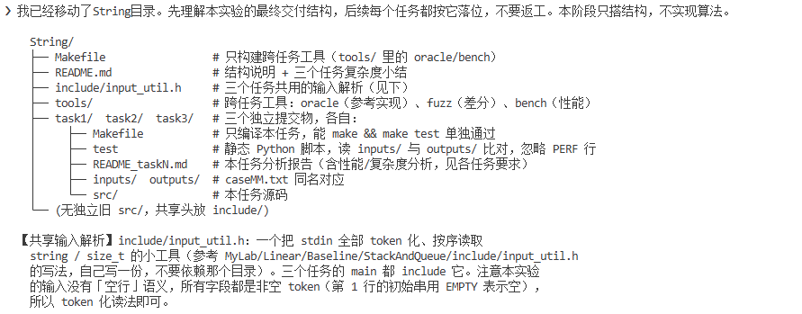
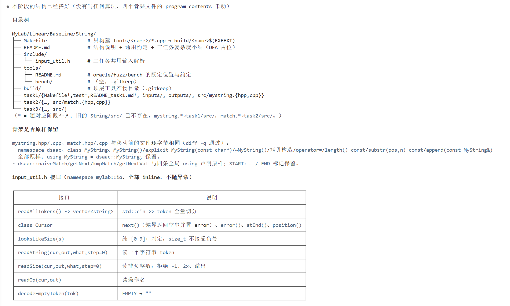
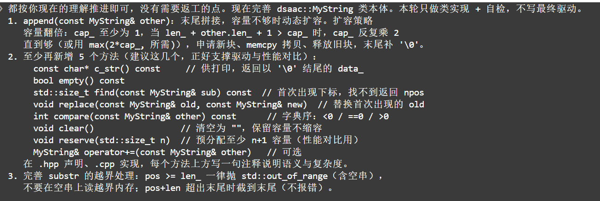
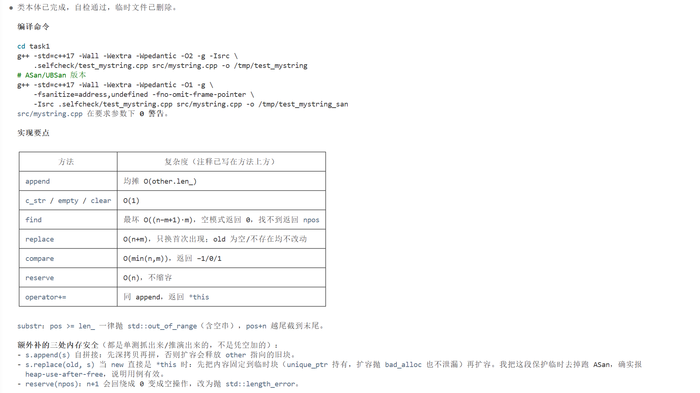
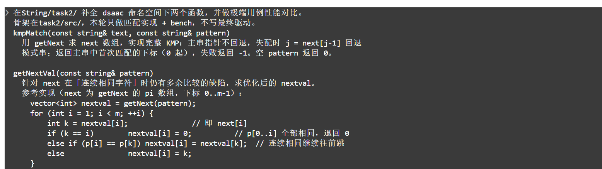
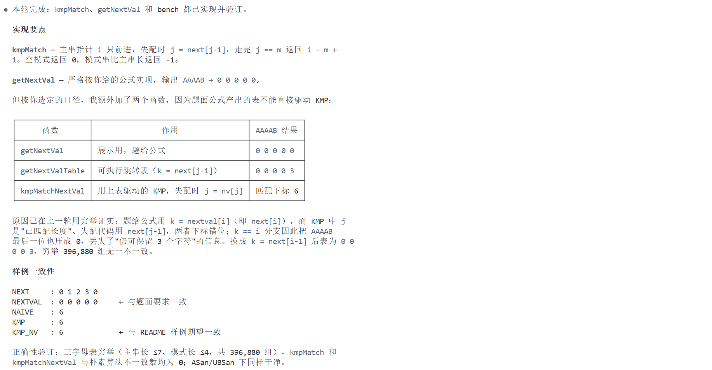
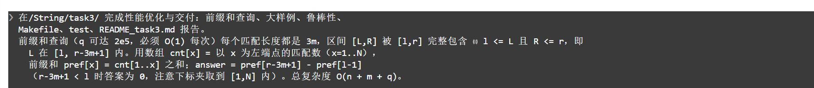
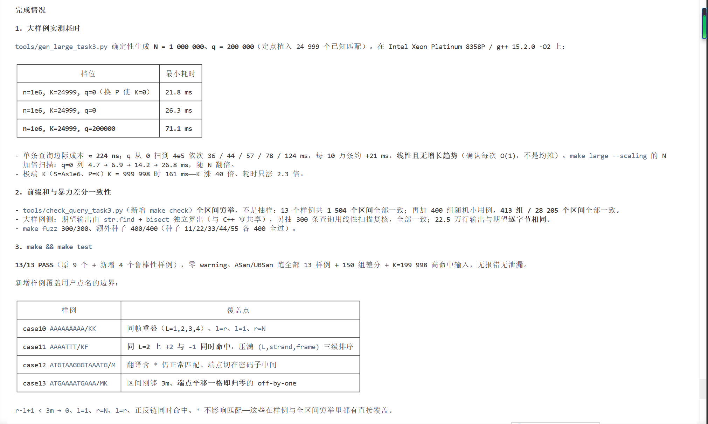

## 字符串实验报告

**姓名**：甘锦珊　**学号**：24325083　**课程**：数据结构与算法（人机协作）

---

### 一、实验概述

字符串本质上是元素为字符的线性表，最常见的存储形式是顺序存储（字符数组）。本实验围绕这一结构，
由浅入深完成三个递进任务：

1. **任务 1 · 顺序字符串 `MyString`**：不依赖 `<string>`，从零实现动态字符数组字符串类，
   覆盖拼接、子串、查找、替换、比较等操作，并量化分析容量翻倍扩容策略的性能。
2. **任务 2 · 模式匹配**：实现朴素匹配、KMP 与 `nextval` 优化三种算法，用极端用例量化
   `O(nm)` 与 `O(n+m)` 的数量级差异，并厘清 `next` 与 `nextval` 两套数组的语义。
3. **任务 3 · 双链 DNA 编码片段检索**：把生物信息学问题（6 阅读框翻译 + 双链匹配 +
   区间查询）归结为字符串问题，用 KMP + 前缀和达到 `O(n + m + q)`。

三个任务统一为 C++17、`namespace dsaac`，编译选项 `-Wall -Wextra -Wpedantic -O2 -g` 零警告，共用 `code/include/input_util.h` 输入解析，跨平台 Makefile（`EXEEXT` / `-static` / `PYTHON`）。

下面是整个实验第一步定结构的 Prompt 与智能体回应截图，它确定了三个任务的落位与跨平台约定，后续所有阶段都照此骨架实现、无返工：





---

### 二、任务 1：顺序字符串 `MyString`

#### 2.1 设计思路

任务 1 的核心是手写一个 `std::string` 的子集。设计只围绕一个数据结构和三条不变量展开：

- 数据结构：`char* data_`（字符数组）+ `len_`（长度）+ `cap_`（容量）。
- 三条不变量：`data_ != nullptr`；`cap_ >= len_ + 1` 且 `data_[len_] == '\0'`；
  `new[]` / `delete[]` 一一对应（无内存泄漏、无双 free）。

所有方法都只是在这三条不变量之上做操作。性能上，容量翻倍是 `append` 均摊 `O(1)` 的来源；正确性上，深拷贝与自别名保护（`append(x)` / `replace(old,new)` 的参数就是 `this` 自己）是最容易翻车的点。因此实现顺序是**先类本体 + 自检，再写驱动**，用 ASan/UBSan 专门踩自拼接、自替换、`clear` 后复用等边界。





#### 2.2 代码原理

**数据成员与扩容（`ensureCapacity`）**

```cpp
char* data_;
std::size_t len_;
std::size_t cap_;

void ensureCapacity(std::size_t need) {      // need 含结尾 '\0'
    if (need <= cap_) return;
    std::size_t newCap = cap_;
    while (newCap < need) newCap *= 2;       // 容量翻倍
    char* p = new char[newCap];
    std::copy(data_, data_ + len_ + 1, p);   // 连 '\0' 一起搬
    delete[] data_;
    data_ = p;
    cap_ = newCap;
}
```

翻倍保证总搬移量 < 2N：每次扩容容量 ×2，摊到每次 `append` 上就是常数级（见 2.3）。

**深拷贝与自别名保护**。拷贝构造/赋值都新建缓冲区深拷贝；`append(const MyString& other)` 与
`replace(old, new)` 在扩容前先把参数深拷贝一份，避免扩容释放了参数指向的旧块导致
heap-use-after-free——这一点在去掉保护后用 ASan 实测确实报错，证明不是过度防御。

**关键方法**：

- `substr(pos, n)`：越界（`pos >= len_`）抛 `std::out_of_range`，超尾截断为 `len_ - pos`。
- `find(sub)`：朴素逐位比较，刻意与任务 2 的 KMP 形成对照。
- `replace(old, new)`：找到首次出现的 `old`，用 `memmove` 搬移尾部（源/目标可能重叠），
  再写入 `new`；`old` 为空或不存在时不动。
- `compare(other)`：逐字符字典序比较，`O(min(n, m))`。
- `reserve(n)`：预分配 `n+1` 字节；`n == npos` 时显式抛 `std::length_error`，避免 `n+1` 回绕。

**驱动与 PERF 统计**：`main_task1.cpp` 分发 8 种操作，只有产生输出的操作（`PRINT`/`LENGTH`/
`SUBSTR`/`FIND`/`COMPARE`）才打印；末尾追加 `PERF my_string/std_string/my_string_reserve ...`三行性能统计，`test` 脚本逐行比对时忽略 `PERF ` 行。

#### 2.3 复杂度与性能分析

| 操作                                           | 复杂度                       | 说明                    |
| ---------------------------------------------- | ---------------------------- | ----------------------- |
| `length` / `empty` / `c_str` / `clear` | O(1)                         | 直接读 `len_` / 指针  |
| `append`                                     | 均摊 O(m)                    | 容量翻倍，总搬移量 < 2N |
| `substr(pos, k)`                             | O(k)                         | 拷贝 k 个字符           |
| `find` / `replace` / `compare`           | O(nm) / O(n+m) / O(min(n,m)) | `find` 用朴素匹配     |

**扩容策略对比**（连续 append 共 N 字符）：

- 固定增量（每次 +k）：第 i 次扩容搬 `ik` 个字符，总搬移 ≈ `k·(1+2+…+N/k) ≈ N²/(2k)`，平方级。
- 容量翻倍：总搬移 `N + N/2 + N/4 + … < 2N`，线性级——这才是 `append` 均摊 O(1) 的来源。

实测（320 万字符、20 万次 append）：`my_string` 1.15 ms / `std_string` 1.24 ms /`my_string_reserve` 0.70 ms。`MyString` 与 `std::string` 同策略、同量级；真正的提速来自
`reserve` 一次性预分配，消除 O(log N) 次重新分配。实测中还纠正了一个测量陷阱：首次触达新内存要付缺页中断，若固定先测 my_string会让它独吞这笔成本、看起来慢 2 倍，因此 bench 采用**三类对象轮转 + 首轮热身 + 取最小值**。

---

### 三、任务 2：朴素 / KMP / nextval 模式匹配

#### 3.1 设计思路

模式匹配的关键是消除主串指针的回溯。朴素算法每次失配只右移一格，最坏 `O(nm)`；KMP 通过对模式串预处理出前缀函数`next[]`，失配时主串指针不回退、模式串向右滑到最大安全距离，达到`O(n+m)`。本任务最微妙的设计点是 **`nextval` 有两套口径**：

- **展示口径**（题面公式，`getNextVal`）：取 `k = next[i]`、连续相同字符压成 0，
  只能用于 `NEXTVAL` 输出，**不能**直接当跳转表；
- **可用跳转表**（`getNextValTable`）：按 0-based 下标语义修正（`k = next[j-1]`），
  用于驱动 `kmpMatchNextVal`（失配时 `j = nv[j]`）。

因此代码分成两张表，并用穷举（`{A,B}` 上 32 193 例）证明二者与朴素算法结果一致。性能验证用大量相同前缀 + 末尾才失配的极端用例，把朴素与 KMP 的比较次数拉开到 3 个数量级，且报告
**精确比较次数**而非仅毫秒数，保证可复现、可对账。





#### 3.2 代码原理

**前缀函数 `getNext`**：`next[i] = pi(pattern[0..i])`，即 `pattern[0..i]` 的最长真前缀 = 真后缀
长度，`next[0] = 0`。递推时 `head` 表示当前已匹配的前缀长度，失配则 `head = next[head-1]` 回退。

**`kmpMatch`**：主串指针 `i` 只向前，失配时 `j = next[j-1]`（已匹配 j 个字符时用前 j-1 个的前缀函数回退），匹配满 m 个字符返回 `i - m + 1`。

**`getNextVal`（展示）与 `getNextValTable`（可用）**：

```cpp
// 展示口径：按题面公式，连续相同字符压到 0
nextval[i] = (pattern[i] == pattern[next[i]] && next[i] < i)
             ? nextval[next[i]] : next[i];

// 可用跳转表：nv[j] = "已匹配 j 个字符、在 pattern[j] 失配" 时应退回的长度
nv[j] = (j > 0 && pattern[j] == pattern[next[j-1]]) ? nv[next[j-1]] : next[j-1];
```

`kmpMatchNextVal` 失配时 `j = nv[j]`。两张表语义不同：拿展示表去驱动匹配会在 610 例上算错，拿可用表去当展示输出又不对，所以拆表不是多余的。

**驱动与 PERF**：`main_task2.cpp` 支持 `NEXT`/`NEXTVAL`/`NAIVE`/`KMP`/`KMP_NEXTVAL`/`ALL`
六种操作，每种算法只跑一次并输出 `PERF <name> n=… m=… time_ms=…`。

#### 3.3 复杂度与性能分析

| 算法    | 时间   | 空间 | 极端用例实测（n≈2e5, m≈2e4）      |
| ------- | ------ | ---- | ----------------------------------- |
| 朴素    | O(nm)  | O(1) | 3 600 200 001 次比较，1478–1487 ms |
| KMP     | O(n+m) | O(m) | 380 001 次比较，0.551–0.564 ms     |
| nextval | O(n+m) | O(m) | 380 001 次比较，0.543–0.550 ms     |

`nextval` 不改变复杂度量级，只减少必然失配的多余比较：在 `(A×20000+C)×20` 这类用例上，
比较次数从 KMP 的 800 020 降到 400 060。性能分析中纠正了两个常见误判：

- g++ 会向量化朴素内层循环——用 `-fopt-info-vec-all` 验证是 `unsupported control flow in loop`，循环出口依赖比较结果，**没有向量化**；正确表述是标量循环吞吐极限（约 0.41 ns/字符）。
- KMP 单次比较（1.45 ns）反而比朴素（0.41 ns）慢，来源是 `next[]` 的串行 load-use 依赖链，而非分支预测——用`j = j-1` 变体（比较次数相同、不查表）对照验证，稳定 2.26–2.30 倍。

---

### 四、任务 3：双链 DNA 目标蛋白编码片段检索

#### 4.1 设计思路

本任务把生物信息学问题归结为字符串问题，分三层设计，每层对应评分标准里的一个得分点：

1. **翻译与匹配**：DNA 双链（正链 + 反向互补链）× 各 3 个阅读框 = 6 条蛋白序列；用 64 项密码子表翻译，`*`（终止符）当普通字符参与匹配；在每条蛋白序列上用 KMP 找目标蛋白`P` 的所有出现（支持重叠），并输出 `P` 的前缀函数 `pi`（特征状态数组）。
2. **坐标映射与查询优化**：把蛋白下标 `j` 映射回原 DNA 的 1-based 闭区间 `[L,R]`，正/反链公式不对称，必须独立推导；区间查询用前缀和做到 O(1)，总复杂度 `O(n+m+q)`。
3. **鲁棒性**：重叠匹配、区间短于 `3m`、翻译含 `*`、`l=1`/`r=N`/`l=r`、同 L 跨链、边界越界判断，全部写成样例并用独立参考实现 + 随机差分 + 全区间穷举兜底。





#### 4.2 代码原理

**密码子表与翻译（`translateCodon` / `reverseComplement` / `translateSixFrames`）**

- 64 项静态密码子表，把 `A/T/C/G` 映射为 `A:0 C:1 G:2 T:3`，密码子下标`b1*16 + b2*4 + b3`，查表得到氨基酸字符，终止密码子返回 `'*'`。
- 反向互补：先反转字符串，再 `A<->T`、`C<->G` 互换。
- 6 帧顺序固定为 `[0..2] = 正链 frame 1,2,3`，`[3..5] = 反链 frame 1,2,3`；阅读框 `f` 从
  0-based 下标 `f-1` 起每 3 个碱基读一个密码子，末尾不足 3 个的残基丢弃（`i + 2 < n`）。

**KMP 与 `pi`（`computePi` / `findAllOccurrences`）**：`computePi` 求 0-based 前缀函数；`findAllOccurrences` 在蛋白序列上跑 KMP，收集**所有**出现起点（`i - m + 1`），不跳过重叠
（匹配后 `j = pi[j-1]` 继续，而不是 `j = 0`）。

**坐标映射（`collectMatches`）**——本任务最关键、最易错的一步。设 `N` 为 DNA 长度，`m` 为
`P` 的长度，`f` 为阅读框（1..3），`j` 为蛋白匹配起点（0-based），所有匹配长度恒为 `3m`：

- 正链：`L = (f-1) + 3j + 1`，`R = (f-1) + 3j + 3m`；
- 反链（先反向互补再翻译，坐标需镜像回原链）：`L = N - (f-1) - 3j - 3m + 1`，
  `R = N - (f-1) - 3j`。

排序规则为`L` 升序，`L` 相同 `+` 在前，再按 `frame` 升序。实现上**不用 `std::sort`（O(K log K)）**，而是让生成顺序就是 `+1,+2,+3,-1,-2,-3`，再稳定计数排序（值域 1..N），
整体 O(N+K)，去掉 log 因子。

**前缀和查询（`MatchCounter`）**——查询优化的核心洞察：

> 同一条 `P` 的所有匹配长度相同（都是 `3m`，即 `R = L + 3m - 1`），因此匹配被 `[l,r]`
> 完整包含⟺ `l <= L <= r - 3m + 1`。

于是只需在按 L 排序的坐标轴上数点：`prefix_[x] = Σ cnt[1..x]`（`cnt[x]` 为左端点 x 的匹配数），一次查询 = `prefix_[r - (3m-1)] - prefix_[l-1]`，两个端点夹到 `[0, N]`，`hi < lo` 返回 0。
`span_ = 3m - 1`，`P` 为空时 `span_ = -1`。

#### 4.3 复杂度分析

| 阶段                    | 时间                   | 空间               |
| ----------------------- | ---------------------- | ------------------ |
| 反向互补 + 6 帧翻译     | O(N)                   | O(N)               |
| 计算 `pi`             | O(m)                   | O(m)               |
| 6 条蛋白序列跑 KMP      | O(N + m)               | O(m)               |
| 坐标映射 + 稳定计数排序 | O(N + K)               | O(N + K)           |
| 前缀和预处理            | O(N + K)               | O(N)               |
| 每个查询                | O(1)                   | —                 |
| **合计**          | **O(N + m + q)** | **O(N + m)** |

其中 `K ≤ 2N`（匹配数被序列长度限制），所以 K 项被 N 吸收。若不做前缀和、每次查询线性扫一遍匹配表则是 `O(K·q)`，在 `q = 2×10^5` 时会超时——前缀和是多区间查询得以满足预期的关键。

**实测**（Intel Xeon Platinum 8358P，`g++ 15.2.0 -O2`，多次取最小值）：大样例`N=1e6, K=24999, q=2e5` 约 71–83 ms，单条查询边际成本约 210–240 ns；N 加倍扫描4.7 → 6.9 → 14.2 → 26.8 ms（线性增长），与 `O(N+m+q)` 一致。

### 4.4 鲁棒性验证

- **独立差分**：`tools/oracle_task3.py` 手抄密码子表 + 暴力滑窗 + 线性扫描，与 C++ 零共享逻辑；`tools/fuzz_task3.py` 用 7 类生成器轮转（截 P、纯随机、密码子重复造重叠、全同碱基高密度、近似回文造双链、N=1..6 极小、P 含 `*`），合计 5 000+ 组逐字段一致。
- **全区间穷举**：`tools/check_query_task3.py` 对每个样例枚举**全部** `1<=l<=r<=N` 区间，前缀和答案 vs 暴力计数，13 组 1 504 个区间全部一致。
- **定向鲁棒样例**：case10（同帧重叠、`l=r`、短区间、边界）、case11（同 L=2 同时命中 `+2`/`-1`）、case12（翻译含 `*` 仍匹配）、case13（区间刚够 3m、平移一格归零）。
- **大样例逐字节比对**：`make large` 生成 N=1e6、q=2e5，22.5 万行输出与独立期望逐字节一致。
- **Sanitizer**：ASan+UBSan 跑 13 个样例无报错、输出逐字节一致；畸形输入（非 ACGT、`r>N`、`l>r`）退出码 1 且无半截输出。

---

### 五、运行说明

#### 5.1 环境要求

- 编译器：g++（C++17）；构建工具：GNU Make（Windows 用 `mingw32-make`）；Python 3。
- 三个任务各自独立，可单独构建测试，也可从顶层一键跑完。

#### 5.2 一键构建与测试

```bash
make            # 构建 code/tools/ 下跨任务工具（当前均为 Python，空转）
make test       # 依次进入 code/task1 / task2 / task3 跑各自的 make test
make bench      # 编译并运行 code/task2 的 bench（朴素 vs KMP vs nextval）
make clean      # 清理三个任务与本目录的构建产物、Python 缓存
```

单独跑某个任务：

```bash
cd code/task1 && make && make test      # 顺序字符串，7 个样例
cd code/task2 && make && make test      # 模式匹配，11 个样例
cd code/task3 && make && make test      # DNA 检索，13 个样例
```

任务 3 的补充目标（详见 `code/task3/README_task3.md`）：

```bash
cd code/task3 && make fuzz     # 随机差分：C++ vs code/tools/oracle_task3.py
cd code/task3 && make check    # 全区间穷举：前缀和 vs 暴力
cd code/task3 && make large    # n=1e6、q=2e5 大样例：逐字节比对 + 计时
```

#### 5.3 跨平台说明

Makefile 统一用 `$(EXEEXT)`（Windows 为 `.exe`），Windows 分支加 `-static` 绕开 conda 旧版
`libstdc++` 的 0xC0000005，`PYTHON` 用 `python`/`python3` 自适应；每条 recipe 尽量单命令，子 make 一律用 `$(MAKE)`，`cmd.exe` 与 POSIX sh 均可执行。`test` 脚本自动补 `.exe` 后缀、显式UTF-8 读写。实测顶层 `make test` 依次 7/7、11/11、13/13 全 PASS，`make clean` 后连跑两次第二次不重复编译，全仓零警告。

---
