## Project1：祖玛游戏实验报告

| 项目 | 内容               |
| ---- | ------------------ |
| 姓名 | 甘锦珊             |
| 学号 | 24325083           |
| 课程 | 数据结构           |
| 日期 | 2026 年 11 月 7 日 |

---

### 一、项目概述

祖玛游戏：若干不同颜色的彩球沿固定轨道依次排列，玩家不断发射新球并插入轨道上的彩球序列中；当轨道上出现连续三个或三个以上相同颜色的彩球时，这些彩球被自动消除，消除后原本分开的两段彩球重新连接，若再次形成三连及以上则继续消除，这一现象称为连锁消除。

本项目在简化规则下（轨道上的球静止不动、玩家每次从待发射队列取球插入指定位置）实现祖玛的核心玩法，并用**栈、队列和链表**三种数据结构分别支撑游戏的不同环节：

- 彩球**轨道** → 双向链表；
- 待发射**队列** → 循环队列；
- **撤销**操作 → 栈。

程序实现了题目要求的全部功能——彩球轨道初始化、彩球发射、指定位置插入、自动消除、连锁消除、撤销操作、游戏胜负判断，并额外设计了两个小道具（炸弹、改色）以增强可玩性、进一步体现数据结构的运用。程序提供交互模式（真人游玩）与批处理模式（自动测试）两种运行方式，前者面向玩家，后者面向测试脚本。

---

### 二、设计思路

#### 2.1 总体架构

整体思路是把游戏状态拆成三个独立的数据结构，再用一个 Game 层组合起来：

| 层         | 组件                | 职责                                                 |
| ---------- | ------------------- | ---------------------------------------------------- |
| 数据结构层 | `Track`           | 双向链表 + 首尾哨兵，表示轨道                        |
|            | `BallQueue`       | 环形缓冲区（循环队列），表示待发射球                 |
|            | `UndoStack`       | 栈，保存历史快照，支持撤销                           |
| 组合层     | `Game`            | 持有三者，实现 fire / bomb / paint / undo 与胜负判定 |
| 输入层     | `main.cpp`        | `--script` 批处理模式；无参数进入交互模式          |
|            | `interactive.cpp` | 命令行界面：预设关卡、局面显示、提示与播报           |

#### 2.2 数据结构选型与理由

**轨道 —— 手写双向链表 + 首尾哨兵。** 消除算法需要以某颗球为起点向**左**和向**右**两个方向同时扫描同色段，删掉一段之后又要把它左右两边的球重新接上。单链表无法向左走；而数组在中间删除需要整体搬移，一次消除的代价是 `O(n)`，连锁消除还会反复发生。双向链表在已经持有节点指针时，删除与两端访问都是 `O(1)`，天然契合这个场景。头尾各放一个哨兵节点，使链表永远非空，插入/删除不必对空链表、头部、尾部做特判；哨兵的颜色固定为 `'\0'`（不是合法彩球色），`Game` 层据此即可判断左右是否还有球，避免把哨兵误当成彩球参与比较。

**待发射队列 —— 手写循环队列（环形缓冲区）。** 游戏只用到队首出一颗、队尾进一颗两种操作。普通数组队列出队后需要整体前移（`O(n)`）；循环队列让 `front/pop/push` 都是 `O(1)`，并且复用同一块缓冲区，反复发射不会产生新的分配。用额外一个空槽区分空/满（底层分配 `cap+1` 个槽），不额外占一个标记位。

**撤销 —— 栈（快照法）。** 每次状态改变前把整份游戏状态压栈，UNDO 时弹出栈顶恢复，栈的后进先出语义天然对应撤销上一步。底层用 `std::vector` 但只暴露栈接口，不使用 `std::stack`。

三者分工明确、互不耦合：`Track` 只管链表、`BallQueue` 只管队列、`UndoStack` 只管历史，`Game` 只负责编排与胜负，任何一层都可以单独编译、单独测试。

#### 2.3 开发过程

本项目开发思路为：把任务拆分为 6 个阶段（阶段 0 至阶段 5），每个阶段以一段明确的 Prompt 提供给智能体，智能体实现并汇报后，再进入下一阶段。下面逐阶段概括每段 Prompt 的**思路**、智能体**回应完成的工作**，并附上对应截图作为过程证据。

##### 阶段 0 · 总纲

**Prompt 思路**：先定好交付结构与通用约定，避免后续返工。核心是三件事——(1) 交付目录布局（`src/` 分文件、`inputs/`+`outputs/` 样例、`test` 测试程序、`Makefile`）；(2) 数据结构选型（轨道=双向链表、发射队列=循环队列、撤销=栈）；(3) `--script` 批处理模式的**确定性 I/O 格式**，让测试程序能逐行精确比对。同时约定跨平台细节（`EXEEXT`、`resolve_exe`）。


**智能体工作**：确认已理解交付结构与 I/O 约定，等待确认后开始实现（本阶段不产代码）。

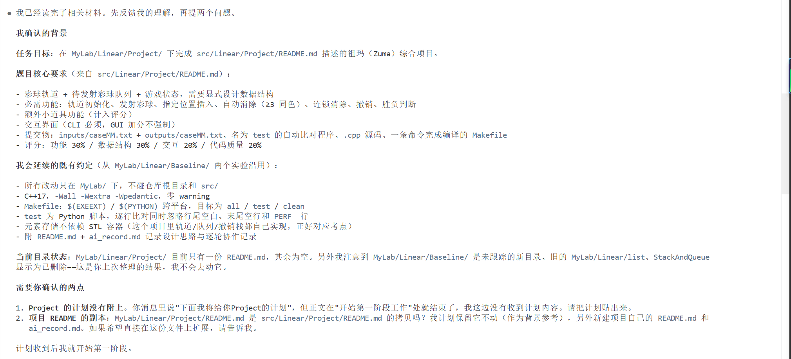

##### 阶段 1 · 三个核心数据结构

**Prompt 思路**：手写三个数据结构并保证各自可独立编译、可自检——`Track`（双向链表 + 首尾哨兵，手动 `new/delete`）、`BallQueue`（环形缓冲区，用额外一个空槽判空/满）、`UndoStack`（栈接口封装的 `std::vector`）,先不做游戏逻辑。

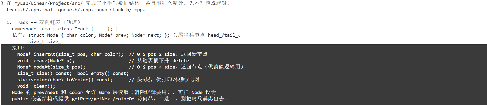

**智能体工作**：完成 `track.h/.cpp`、`ball_queue.h/.cpp`、`undo_stack.h/.cpp` 三个类；写了临时自检程序，覆盖 pos=0/中间/末尾插入删除、clear 后复用、环形回绕、空队异常、LIFO 顺序等边界，在普通构建与 ASan/UBSan 下全部通过，验证后删除临时自检。确立了哨兵 `color='\0'`这一 Track 与 Game 之间的约定。期间修复了Track 构造时第二个哨兵分配失败会泄漏第一个的异常安全细节。

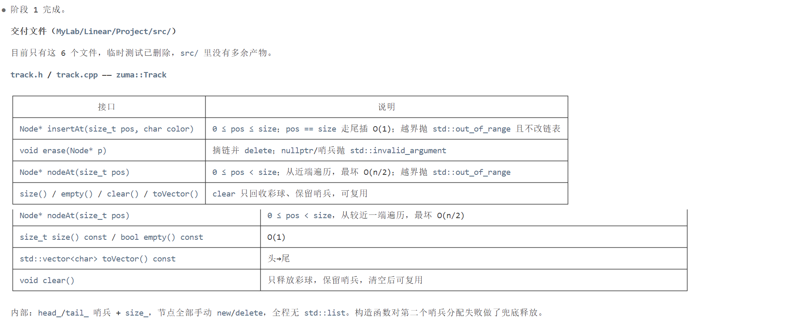

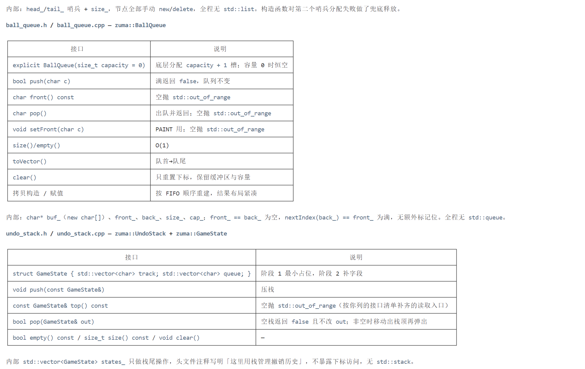

##### 阶段 2 · 游戏核心逻辑与批处理驱动

**Prompt 思路**：实现 `Game` 的核心玩法——初始化、发射（队首出队 + 指定位置插入）、自动消除、连锁消除，并让 `main.cpp --script` 跑通基本样例。重点是 `eliminateFrom(Node*)` 的找极大同色段 → ≥3 删除 → 左右同色则连锁算法。

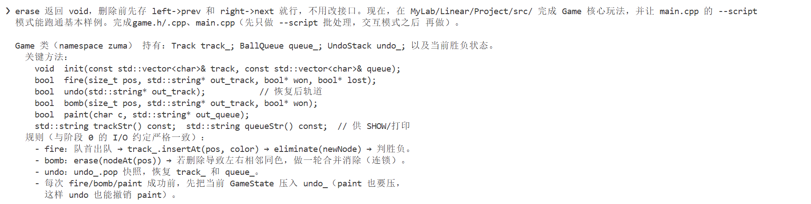

**智能体工作**：完成 `game.h/.cpp`、`main.cpp` 及 `case01/case02` 样例。`eliminateFrom` 采用找段 → 删段 → 换探针的循环，删段前先记下 `left_ball`/`right_ball`，只有两者都存在且同色才把探针移过去继续连锁。`GameState` 补齐了 `won`/`lost` 标志（否则FIRE 判负后 UNDO会残留胜负状态）。用独立 Python 参考实现做 3000 组随机差分测试，0 处不一致；ASan/UBSan 下复跑同样通过。

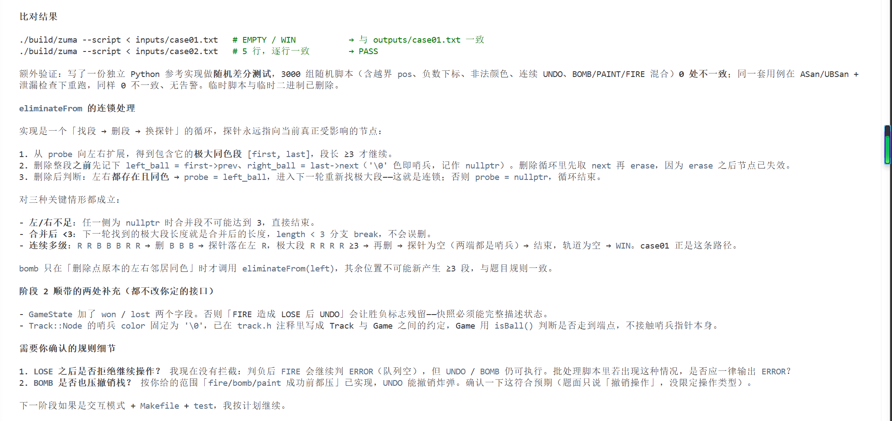

##### 阶段 3 · 撤销 / 胜负 / 小道具

**Prompt 思路**：补全撤销、胜负判定与小道具，并补样例。要求 UNDO 能回退 fire/bomb/paint 三种操作、空栈报错；胜负统一在 fire/bomb 后判定；道具 `BOMB`（炸一颗球）与 `PAINT`（改队首颜色）都可撤销。

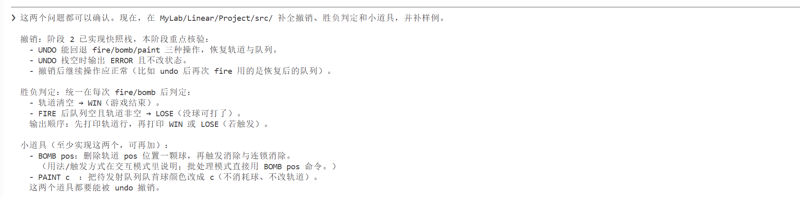

**智能体工作**：补齐 `case03–05`，5 个样例全部逐行一致。修复了 `bomb` 无条件清除失败标志的问题（改为只在真正清空轨道时才清）。将 `main.cpp` 输入解析改为整份输入按行切分、每条命令独立解析，拒绝 `-1`、`1x`、空串等非法计数，兼容 CRLF，解决了原先 `std::cin >>` 失败后会把下一行命令一起吞掉的错位问题。再做 4000 组随机差分（含非法参数、连续 UNDO），0 处不一致。

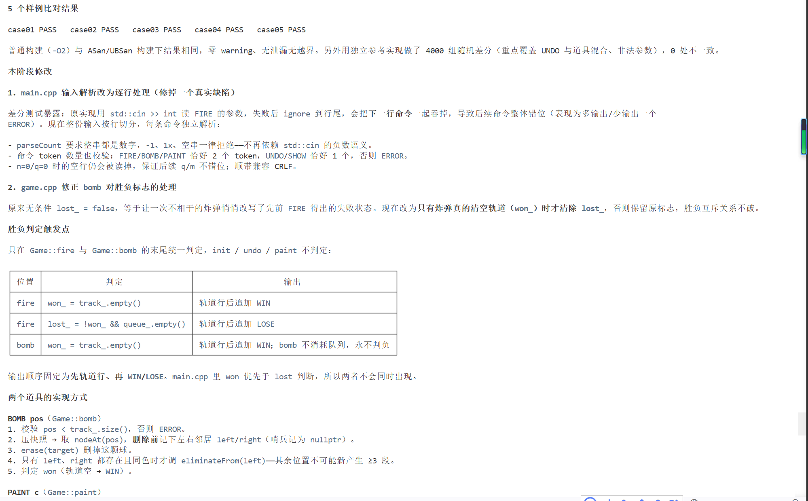

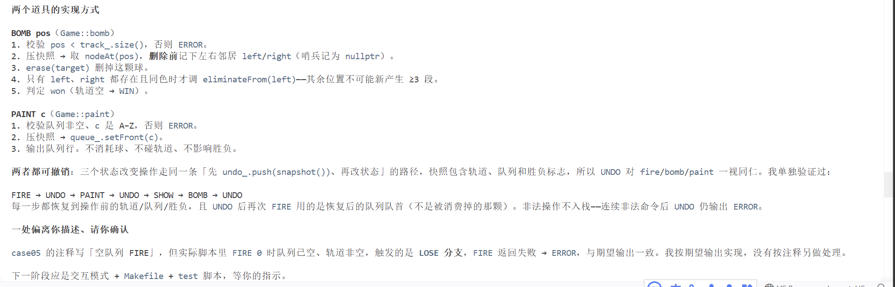

##### 阶段 4 · 用户交互

**Prompt 思路**：补上无参数运行进入的交互模式——开局选预设关卡或自定义、每轮显示带编号轨道与队首/队列/已发射数、命令菜单、消除播报消除了 N 个 X 球、WIN/LOSE 后询问重开。

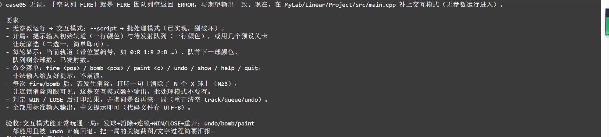

**智能体工作**：新增 `interactive.h/.cpp`（`main.cpp` 只负责分发交互/批处理）。`Game` 增加 `Elimination`/`lastEliminations()`/`shots()`/`undoSize()`/`colorAt()`/`frontColor()` 等接口，`GameState` 带上 `shots`；`Track` 补 const 版 `nodeAt()`。内置 3 个预设关卡，队列为空时给出只能用 bomb 清球提示。实测一局 `fire 4 → 消除 3 个 B + 4 个 R → WIN → 重开`，自定义局验证 bomb 合并消除、undo 完整恢复、paint、LOSE；10 类非法输入均给针对性提示、无崩溃。

##### 阶段 5 · 收尾（构建 / 测试）

**Prompt 思路**：收成可一键编译、一键测试的状态——`Makefile`（`EXEEXT` 记账避免 Windows 重编）、`test` 测试脚本（`resolve_exe` 补 `.exe`、逐行比对）、补齐边界样例、README 写足报告。

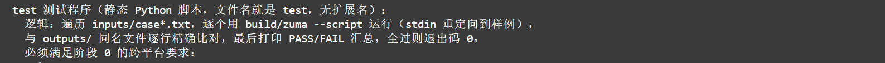

**智能体工作**：新增 `Makefile`、`test`、`.gitignore`，重写 `README.md` 为完整报告；补齐 `case06–10`（单轮消除、非法参数与越界、空轨道空队列、道具组合 + PAINT 撤销、最小 FIRE→WIN）。10 个样例在普通构建与 ASan/UBSan 下全部 PASS、零警告。修复了目标名不带 `$(EXEEXT)` 导致 Windows 每次重编`test` 文件句柄未关闭等问题。

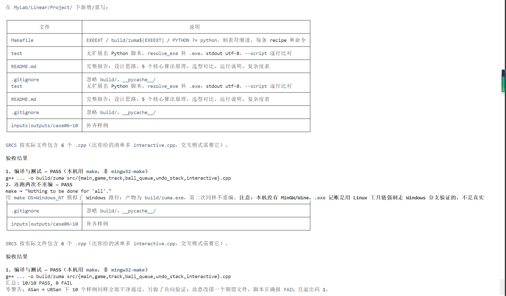

---

### 三、核心功能函数代码原理解释

#### 3.1 轨道 `Track`：双向链表 + 首尾哨兵

节点结构为 `struct Node { char color; Node* prev; Node* next; }`，首尾各放一个颜色为 `'\0'` 的哨兵节点，链表永远非空。核心操作：

**`insertAt(pos, color)`**：校验 `0 ≤ pos ≤ size` 后，找到插入位置之后的节点 `next`（`pos == size` 时直接取尾哨兵，追加无需遍历），取 `prev = next->prev`，新建节点接进 `prev` 与 `next` 之间。定位是 `O(min(pos, n-pos))`（`nodeAt` 从较近一端走），链接本身 `O(1)`，尾部追加纯 `O(1)`。

**`erase(p)`**：校验 `p` 非空且非哨兵后，只做 `p->prev->next = p->next; p->next->prev = p->prev; delete p; --size;`，给定指针时严格 `O(1)`。调用方若之后还要访问 `p` 的邻居，必须在 `erase` 之前先把它们存下来。

#### 3.2 自动消除与连锁消除 `Game::eliminateFrom(Node* p)`

这是整个项目的核心算法。入口是插入/删除后最可能受影响的节点 `p`，循环执行三步：

```text
while (p 是真实彩球) {
  1) 以 p 为中心，向左扩张到 first、向右扩张到 last，
     得到包含 p 的极大同色段 [first, last]，长度为 length；
  2) 若 length < 3 —— 不会消除，直接结束；
  3) 否则：
     a. 先记下删除后将成为左右邻居的 left_ball / right_ball（哨兵记为 nullptr）；
     b. 从 first 删到 last（逐节点 erase）；
     c. 若 left_ball 与 right_ball 都存在且同色，令 p = left_ball 继续下一轮（连锁）；
        否则结束。
}
```

#### 3.3 待发射队列 `BallQueue`：环形缓冲区

底层分配 `cap_ + 1` 个槽，多留一格区分空/满：

```text
front_ == back_                  → 空
nextIndex(back_) == front_        → 满
nextIndex(i) = (i + 1 == cap_ + 1) ? 0 : i + 1
```

- `push`：先算 `next = nextIndex(back_)`，若 `next == front_` 返回失败（队列不变），否则写入并回绕 `back_`；
- `pop`：空队抛 `out_of_range`，否则取 `buf_[front_]` 并让 `front_` 回绕；
- `setFront`：`PAINT` 使用，改队首颜色但不移动指针。

#### 3.4 撤销栈 `UndoStack`（快照法）

每次 `FIRE / BOMB / PAINT` 真正改状态之前，把这一刻的完整状态打成 `GameState` 压栈：

```cpp
struct GameState {
    std::vector<char> track;   // 轨道头 → 尾
    std::vector<char> queue;   // 队列队首 → 队尾
    bool won, lost;            // 该时刻的胜负标志
    std::size_t shots;         // 该时刻的累计发射数
};
```

`UNDO` 时弹出栈顶、用它覆盖当前状态，LIFO 语义天然对应撤销上一步。

**为什么把胜负标志也放进快照**：如果只恢复轨道和队列，FIRE 判负后 UNDO会留下残留的 `lost_` 标志，游戏会被错误判定为已结束。把 `won/lost/shots` 一起快照，撤销后的显示与计数才完全一致。

---

#### 3.5 用户交互设计

程序支持两种运行模式：

**交互模式**（无参数运行）：开局可选预设关卡（3 个）或自定义轨道/队列；每轮显示带下标编号的轨道、队首球、队列剩余、已发射数与可撤销步数；支持 `fire / bomb / paint / undo / show / help / quit` 命令，非法输入给出针对性提示；发生连锁消除时逐条播报消除了 N 个 X 球；判定 `WIN / LOSE` 后询问是否再来一局。

**批处理模式**（`--script`）：从 stdin 读固定格式脚本，输出确定结果，供测试程序自动比对，不输出任何提示语。两种模式由 `main.cpp` 用命令行参数分发，互不影响。

---

### 四、运行说明

#### 5.1 编译

在项目目录下：

```bash
make                 # Linux / macOS
mingw32-make         # Windows（MinGW）
```

产物为 `build/zuma`（Windows 下自动为 `build/zuma.exe`）。编译参数 `-std=c++17 -Wall -Wextra -Wpedantic -O2 -g`，零警告。

#### 5.2 测试

```bash
make test            # 或 mingw32-make test（Windows）
```

`test` 自动遍历 `inputs/case*.txt`，用 `build/zuma --script` 逐个运行，与 `outputs/` 同名文件逐行比对，打印 `PASS/FAIL` 汇总，全部通过退出码 0。

#### 5.3 玩游戏

```bash
./build/zuma         # Windows: build\zuma.exe
```

#### 5.4 批处理模式（测试用）

```bash
./build/zuma --script < inputs/case01.txt
```

---

### 五、复杂度小结

| 操作                                         | 时间                   | 空间          |
| -------------------------------------------- | ---------------------- | ------------- |
| `Track::insertAt` 定位下标                 | `O(min(pos, n-pos))` | `O(1)`      |
| `Track::insertAt` 链接（含尾部追加）       | `O(1)`               | `O(1)`      |
| `Track::erase(节点指针)`                   | `O(1)`               | `O(1)`      |
| `Track::toVector`                          | `O(n)`               | `O(n)`      |
| `BallQueue::push / pop / front / setFront` | `O(1)`               | `O(1)`      |
| 一次 FIRE / BOMB（含全部连锁消除）           | `O(n)`               | `O(1)` 额外 |
| 一次 PAINT                                   | `O(1)`               | `O(1)`      |
| 压入快照                                     | `O(n + q)`           | `O(n + q)`  |
| 一次 UNDO                                    | `O(n + q)`           | 释放一份快照  |

其中 `n` 为轨道球数，`q` 为待发射球数。

---
