## 树结构实验报告

**姓名**：甘锦珊　**学号**：24325083　**课程**：数据结构与算法（人机协作）

---

### 一、实验概述

本实验包含两个相互独立的 Baseline 任务，共同构成树结构部分的交付内容：

1. **森林与二叉树的转换（`forest/`）**：用左孩子右兄弟（LCRS）表示法把任意森林映射成
   二叉树并还原，同时实现森林的前序、后序遍历，验证森林前序 = 二叉树前序、
   森林后序 = 二叉树中序两条不变式。
2. **哈夫曼树与编码（`huffman/`）**：用最小堆贪心构造哈夫曼树，DFS 生成前缀编码，
   计算带权路径长度 WPL，并结合题面样例讨论前缀码、Kraft 不等式与最优性。

两个任务都使用 C++17、`namespace dsaac`，编译选项为
`-std=c++17 -Wall -Wextra -Wpedantic -O2 -g`，要求零警告。每个子目录自带
`Makefile`、Python 测试脚本 `test`、`inputs/` 与 `outputs/`，顶层
`MyLab/Tree/Baseline/Makefile` 提供 `make` / `make test` / `make clean` 三个入口。
整个目录即提交物 `甘锦珊_24325083_Tree`，与 `甘锦珊_24325083_String` 并列存放。

下面是实验开始时确定交付结构与工程约定的 Prompt 及智能体复述，后续所有阶段都在这个
骨架上推进，没有出现返工：


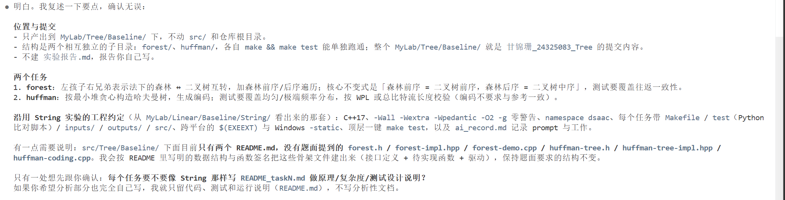

---

### 二、任务 1：森林与二叉树的转换（forest）

#### 2.1 设计思路

森林由若干棵一般树组成，一般树的度不固定，直接用孩子数组存储虽然直观，但不便于
套用二叉树的遍历与递归结构。左孩子右兄弟表示法只用两个指针就编码了全部信息：

- 节点的**第一个孩子**成为二叉树中的**左孩子**；
- 节点的**其余孩子**依次成为前一个兄弟的**右孩子**，形成一条右兄弟链；
- 森林中第一棵树的根作为二叉树的根，**其余各树的根依次挂在根节点的右链上**。

于是森林被当成各树根互为兄弟来处理，一棵普通二叉树就能无损承载整片森林。
任务要求的四个函数 `forest_to_binary_tree`、`binary_tree_to_forest`、
`forest_preorder`、`forest_postorder` 都围绕这一映射展开。

文件职责在开工前就定死了，避免头文件被 I/O 代码污染：

- `forest.h`：只放 `ForestNode`、`Forest`、`BinaryTreeNode` 三个定义与四个函数声明；
- `forest-impl.hpp`：四个函数的实现，外加演示打印用的二叉树前序/中序；
- `tree_io.h`：只做输入解析与输出排版，是格式契约，不含任何树算法；
- `forest-demo.cpp`：读入森林、调用四个函数、按固定格式输出。

这一分工是在智能体提出`tree_io.h` 放哪里之后确认的，同时确认了样例保留
case01、期望输出以实跑为准等几条约定：

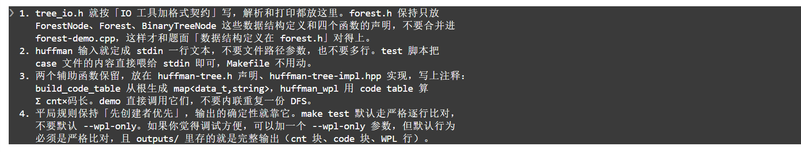

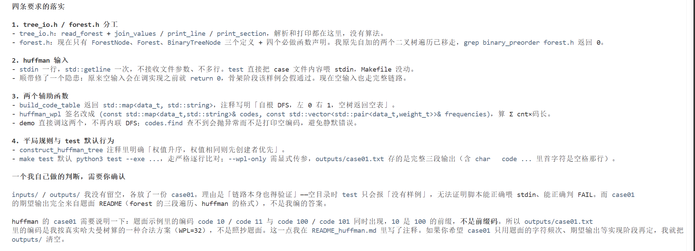

输入采用括号表示法：第一行是树的棵数 `k`，随后 `k` 个 token 各表示一棵树，节点标签是
单个可见 ASCII 字符（`0x21`–`0x7E`，不能是空白、逗号或括号）。输出固定三节六行，
排版与题面预期输出逐字对齐，任何一组序列为空时该行到冒号结束、不留行尾空格。

#### 2.2 代码原理

**数据结构**。一般树用变长孩子表，森林是根节点指针的数组；二叉树固定左右两个指针：

```cpp
template <typename T>
struct ForestNode {
    T data;
    std::vector<std::unique_ptr<ForestNode>> children;
    static std::unique_ptr<ForestNode> get_new_node(const T &value);
};

template <typename T>
using Forest = std::vector<std::unique_ptr<ForestNode<T>>>;

template <typename T>
struct BinaryTreeNode {
    T data;
    std::unique_ptr<BinaryTreeNode> left;
    std::unique_ptr<BinaryTreeNode> right;
};
```

全部所有权由 `unique_ptr` 表达，转换时用 `std::move` 转移，不存在手工 `delete`。

**森林 → 二叉树**。先写单棵树 `tree_to_binary`：根照抄，第一个孩子递归转换后接
`left`，其余孩子依次接到前一个兄弟的 `right` 上。关键是尾指针 `tail`，使每条兄弟链
的追加都是 O(1)，而不是每次从头找尾：

```cpp
auto out = BinaryTreeNode<T>::get_new_node(node.data);
if (node.children.empty()) return out;

out->left = tree_to_binary(*node.children.front());
BinaryTreeNode<T> *tail = out->left.get();
for (std::size_t i = 1; i < node.children.size(); ++i) {
    tail->right = tree_to_binary(*node.children[i]);
    tail = tail->right.get();
}
return out;
```

森林层再把各棵树串起来：第一棵树的转换结果是根，之后每棵树的根接到当前根右链的末端。
新建的根节点 `right` 一定为空，所以直接挂接不会覆盖已有内容。

**二叉树 → 森林**。这是上一步的逆过程，要点是两条链分层消费：

```cpp
for (const BinaryTreeNode<T> *child = node.left.get(); child != nullptr;
     child = child->right.get()) {
    out->children.push_back(binary_node_to_tree(*child));
}
```

递归只处理 `left` 及其下方子树，`right` 兄弟链由当前层的循环接管。如果递归里再把
`child->right` 当作孩子传下去，同一个兄弟节点就会被创建两次（一次作为兄弟、一次作为
孩子），这是本任务最容易写错的地方。森林层则沿根的 `right` 链走，每个节点还原成一棵
树，恰好对应各树根互为兄弟的约定。

**遍历**。森林前序对每棵树先根后子树，森林后序先子树后根；二叉树的先序与中序
只用于演示对照。四个函数都只访问每个节点一次。

**输入解析**。`tree_io.h` 把 stdin 全部切成 token，第一个转成棵数 `k`，其余用递归下降
解析：

```text
node := label [ '(' node (',' node)* ')' ]
```

解析器校验标签合法性、括号闭合、逗号/右括号位置与 token 总数；任何不合法输入都抛
`std::runtime_error`，由 `main` 输出 `ERROR:` 到 stderr 并以 1 退出，stdout 不留半截
输出。棵数还设了 1e6 的上限，防止构造超大森林。

输出由 `print_line` 统一排版：标签左对齐到第 18 列，元素之间一个空格，空序列不留行尾
空格，节与节之间一个空行。这样 case05（空森林）的六行也逐字可对。

#### 2.3 复杂度

设森林与对应二叉树共有 `n` 个节点，树高为 `h`。

| 函数                      | 时间 | 空间                    |
| ------------------------- | ---- | ----------------------- |
| `forest_to_binary_tree` | O(n) | O(n) 结果 + O(h) 递归栈 |
| `binary_tree_to_forest` | O(n) | O(n) 结果 + O(h) 递归栈 |
| `forest_preorder`       | O(n) | O(h) 递归栈 + O(n) 结果 |
| `forest_postorder`      | O(n) | O(h) 递归栈 + O(n) 结果 |

每个节点在转换中恰好创建一次、在遍历中恰好访问一次；兄弟链用 `tail` 指针 O(1) 追加，
没有内层扫描，因此不会退化为 O(n²)。递归栈深度等于树高，退化链上 `h = n`，最坏额外
空间是 O(n)；若需要严格 O(1) 额外空间可改为显式栈迭代，本任务不要求。

解析与打印都是 O(输入长度)，与节点总数同阶。

#### 2.4 测试与结果

驱动程序的输入格式、解析与排版在阶段 2 中实现，六个样例同时覆盖了多树深链
宽兄弟空森林等形态：


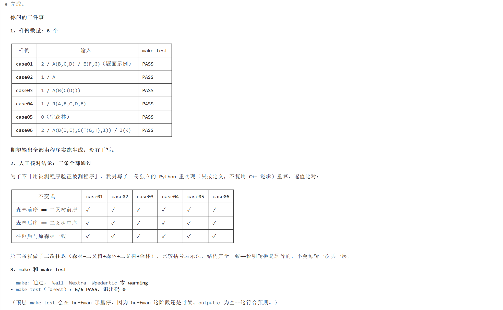

| 样例   | 输入                                         | 覆盖点                     | 结果 |
| ------ | -------------------------------------------- | -------------------------- | ---- |
| case01 | `2` / `A(B,C,D)` / `E(F,G)`            | 题面示例：多孩子 + 多树    | PASS |
| case02 | `1` / `A`                                | 单节点：最小非空森林       | PASS |
| case03 | `1` / `A(B(C(D)))`                       | 深链：全部是左孩子         | PASS |
| case04 | `1` / `R(A,B,C,D,E)`                     | 宽兄弟：一条长右链         | PASS |
| case05 | `0`                                        | 空森林：空序列不留行尾空格 | PASS |
| case06 | `2` / `A(B(D,E),C(F(G,H),I))` / `J(K)` | 多树 + 多孩子 + 不同深度   | PASS |

以 case06 为例的实际值：

```text
森林前序   A B D E C F G H I J K
森林后序   D E B G H F I C A K J
二叉树前序 A B D E C F G H I J K   ← 与森林前序一致
二叉树中序 D E B G H F I C A K J   ← 与森林后序一致
```

`make test` 的汇总为 **6/6 PASS**。此外用另一份独立 Python 实现对 500 组随机森林
（随机棵数、随机度数、随机深度，标签覆盖全部可见 ASCII）逐组复算六行输出，
0 失败；随机用例中包含空森林、单节点、纯深链与纯宽兄弟。

---

### 三、任务 2：哈夫曼树的构造与编码（huffman）

#### 3.1 设计思路

哈夫曼树是使带权路径长度（WPL）最小的二叉树。构造是经典的贪心过程：每个字符建一个
叶子，反复取出权值最小的两棵子树合并，直到只剩一棵。要把它做成可自动判分的实验，
有三个设计点必须提前定死：

1. **确定性的平局规则。** 权值相同的节点弹出顺序不同，树的形状与 0/1 编码就会不同，
   样例便无法逐行比对。因此给每个节点编号，按 `(weight 升序, id 升序)` 弹出：
   第 `i` 个叶子的 `id = i`（与输入顺序一致），内部节点继续递增编号。同一份输入
   永远得到同一棵树、同一张编码表。
2. **非交互式 I/O。** 题面示例是交互式程序（先打印提示语再读入），不便自动比对。
   本实现改为从 stdin **第一行**读整行文本，不做 trim，空行/空文件当作空串；这样
   `inputs/caseNN.txt` 可以原样喂给程序，测试脚本直接比对 stdout。
3. **辅助函数显式保留。** 编码表构建 `build_code_table` 与 WPL 计算 `huffman_wpl`
   都作为独立接口放在 `huffman-tree.h`，驱动只调用它们，不在 `main` 里再写一份 DFS，
   保证打印出来的编码与报告的 WPL用的是同一份数据。

题面示例的编码存在一个必须先纠正的问题：样例同时给出 `10` / `11` 与 `100` / `101`，
`10` 是 `100`、`101` 的前缀，**这组编码不是前缀码**。按 Kraft 不等式，
`6×2⁻³ + 2×2⁻² = 1.25 > 1`，这样的前缀码在数学上不可能存在，题面的 28 bit 也不可达；
按真实哈夫曼树合并（`1+1=2` 三次、`2+2=4` 两次、`3+4=7`、`4+7=11`），内部节点权值
之和为 **32**。这一点在实现前就通过补充 Prompt 确认，并以 32 作为样例基准：

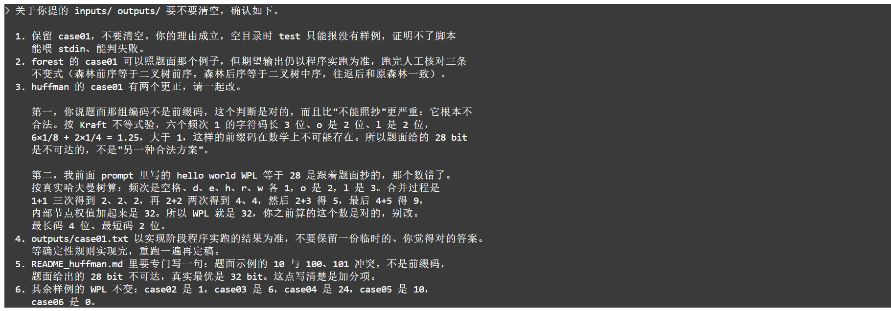

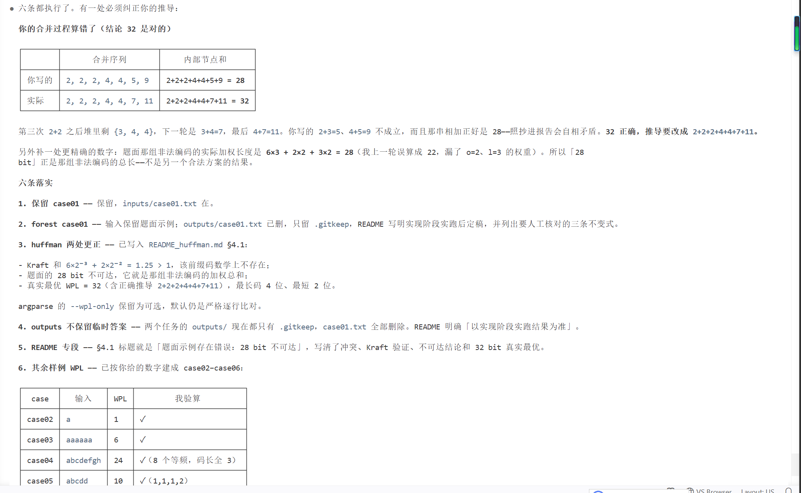

#### 3.2 代码原理

**数据结构**。`Node` 是通用的 N 叉节点，`N` 默认为 2；载荷用 `std::optional` 区分
叶子与内部节点，不必额外存标志位：

```cpp
template <typename T, std::size_t N = 2>
struct Node {
    T data;
    std::array<std::unique_ptr<Node>, N> children;
    static std::unique_ptr<Node> get_new_node(const T &value);
};

template <typename data_t, typename weight_t>
struct HuffmanTreeNodeData {
    std::optional<data_t> data;   // 叶子有字符，内部节点为 nullopt
    weight_t weight;              // 该子树的权值和
};

template <typename data_t, typename weight_t>
using HuffmanTreeNode = Node<HuffmanTreeNodeData<data_t, weight_t>, 2>;
```

**最小堆贪心**。`std::make_heap` 建立的是大顶堆，`comp(a,b) == true` 表示 `a` 排在
`b` 之后；要小的先弹，比较器必须反着写：

```cpp
bool operator()(const HeapEntry &a, const HeapEntry &b) const {
    if (a.node->data.weight != b.node->data.weight) {
        return a.node->data.weight > b.node->data.weight;
    }
    return a.id > b.id;
}
```

循环中弹出两次：先弹出的作左孩子，后弹出的作右孩子；新内部节点的权值为两者之和，
`data` 为 `nullopt`，再压回堆。`n` 个叶子经过 `n−1` 次合并后堆中只剩根。节点用
`unique_ptr` 持有，合并时整体 `std::move`，不拷贝子树。

**编码表**。从根做一次 DFS，左转记 `'0'`、右转记 `'1'`，走到 `data.has_value()` 的
叶子时把当前路径写入 `map<字符, 编码>`。用 `map` 而不是按 DFS 顺序的向量，是为了让
打印结果按字符升序稳定输出，与遍历顺序无关。

**单字符边界**。字符集只有一个字符时，贪心一次也不合并，根即叶子，路径为空。若取
码长 0，原文写不出任何比特，无法还原，因此约定编码为 `"0"`（长度 1），
`WPL = 该字符频次`。`a` 的 WPL 是 1，`aaaaaa` 的 WPL 是 6，而不是 0。

**WPL**。`huffman_wpl` 直接按 `Σ(频次 × 码长)` 累加；编码表缺字符时返回 0，驱动发现
缺项会抛异常，而不是静默打印一个错误的数。

#### 3.3 正确性：前缀码、最优性与复杂度

**为什么一定是前缀码。** 只有叶子携带字符，内部节点的 `data` 是 `nullopt`；树中两个
不同叶子不可能互为祖先（每个节点只有一个父节点）。一条编码就是从根到该叶子的路径，
若编码 A 是编码 B 的前缀，A 对应的叶子就在根到 B 的路径上，即 A 是 B 的祖先，矛盾。
因此任意两条编码互不为前缀，解码从左到右扫一遍即可，无歧义。

**为什么最优（交换论证）。** 先注意恒等式 **WPL = 所有内部节点权值之和**：每条根到叶
的路径上，每经过一个内部节点，该叶子的权值就被计一次，累计恰好是叶子的深度。于是
最小化 WPL 等价于最小化每次合并的代价之和。

设 `a`、`b` 是权值最小的两个叶子。取任意最优树 T：最优树中不存在只有一个孩子的内部
节点（否则收缩该节点会让所有叶子深度减 1、WPL 严格下降），故可取最深的一对兄弟
`y`、`z`。把 `a` 与 `y`、`b` 与 `z` 交换（只换字符和权值，不换形状），WPL 的增量为

```text
Δ = (w_y − w_a)(d_a − d_max) + (w_z − w_b)(d_b − d_max) ≤ 0
```

因为 `w_a ≤ w_y`、`w_b ≤ w_z` 且 `d_max ≥ d_a, d_b`，所以交换后仍是最优树，且 `a`、`b`
占据了最深兄弟的位置。把它们合并成权值 `w_a + w_b` 的新叶子，问题规模减 1，且
`WPL(T) = WPL(T') + (w_a + w_b)`。哈夫曼的第一步正是合并最小权值的两个叶子，子问题
递归可用同样论证，因此贪心每一步都不丢最优解，最终 WPL 最小。

**复杂度。** 建堆 O(n)；共 `n−1` 次合并，每次两次 `pop_heap` 加一次 `push_heap`，
均为 O(log n)，合计 O(n log n)。编码 DFS 每个节点访问一次，每个叶子插入一次 `map`
（O(log n)），同阶；WPL 计算 `n` 次查找，O(n log n)。空间上共 `2n−1` 个节点，
堆最多 `n` 项，编码表 O(n × 最长码长)，递归栈最坏 O(n)（极端偏斜）。

#### 3.4 测试与结果

实现阶段先自检核心函数，再做驱动与样例：

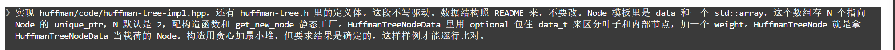

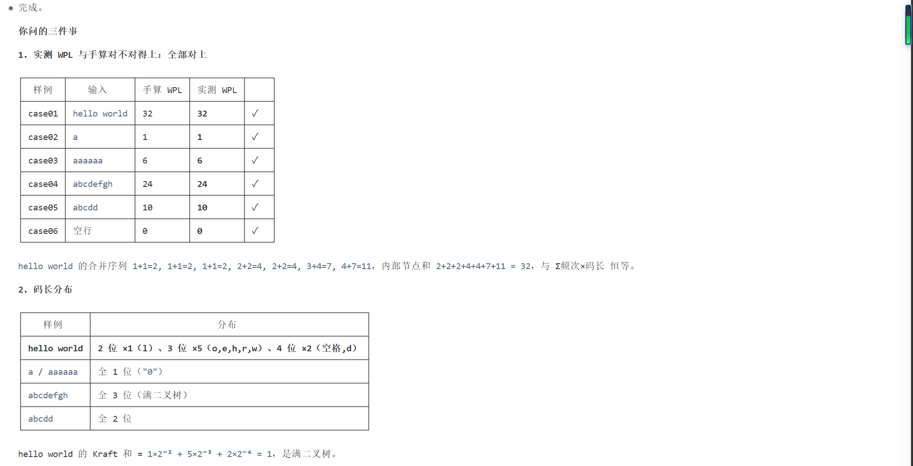

驱动输出三段：频次行 `char <c> cnt <n>`、编码行 `char <c> code <bits>`（两段顺序一致，
均按次数升序、同次数按字符升序）、末行 `WPL <total>`；空输入输出 `EMPTY` 与 `WPL 0`。
字符位置直接打印字符本身，空格那一行就是 `char   cnt 1`。八个样例的期望输出均由程序
实跑生成，WPL 先手算核对：

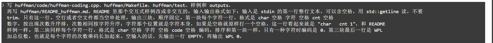

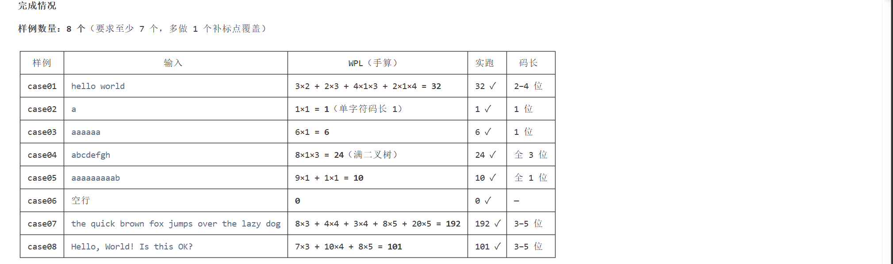

| 样例   | 输入                                            | 手算 WPL                                | 实跑 WPL | 码长    | 结果 |
| ------ | ----------------------------------------------- | --------------------------------------- | -------- | ------- | ---- |
| case01 | `hello world`                                 | 3×2 + 2×3 + 4×1×3 + 2×1×4 = 32    | 32       | 2–4 位 | PASS |
| case02 | `a`                                           | 1×1 = 1                                | 1        | 1 位    | PASS |
| case03 | `aaaaaa`                                      | 6×1 = 6                                | 6        | 1 位    | PASS |
| case04 | `abcdefgh`                                    | 8×1×3 = 24                            | 24       | 全 3 位 | PASS |
| case05 | `aaaaaaaaab`                                  | 9×1 + 1×1 = 10                        | 10       | 全 1 位 | PASS |
| case06 | 空行                                            | 0                                       | 0        | —      | PASS |
| case07 | `the quick brown fox jumps over the lazy dog` | 8×3 + 4×4 + 3×4 + 8×5 + 20×5 = 192 | 192      | 3–5 位 | PASS |
| case08 | `Hello, World! Is this OK?`                   | 7×3 + 10×4 + 8×5 = 101               | 101      | 3–5 位 | PASS |

case01 的编码表与校验：

```text
char   code 1110    char d code 1111    char e code 000    char h code 001
char r code 010     char w code 011     char o code 110    char l code 10
WPL 32
```

Kraft 和 = `1×2⁻² + 5×2⁻³ + 2×2⁻⁴ = 1`，是一棵满二叉树；任意两条编码互不为前缀。
`hello world` 共 11 个字符，定长 8 位需要 88 bit，哈夫曼编码只需 32 bit，压缩到 36.4%。
均匀分布（case04）压缩到 3/8 = 37.5%，这是字符种类恰为 2 的幂时的极限；极端偏斜
（case05）压缩到 12.5%，说明哈夫曼对频率差异大的分布收益最大。

`make test` 汇总 **8/8 PASS**。另外用独立 Python 参考实现（`heapq`，不复用 C++ 代码）
对 **3000 组随机字符串**（长度 0–40，字符集 1–12 种）逐组校验：频次统计、编码集合、
前缀码性质、Kraft 和 ≤ 1、`WPL` 行与 `Σ(次数×码长)` 及参考值一致，**0 失败**。

---

### 四、工程整合与全量测试

两个任务完成后，顶层 Makefile 负责一键构建与测试，并处理跨平台细节：

- `make` 依次进入 `forest`、`huffman` 编译；`make test` 依次跑两个子目录的测试，
  `forest` 失败时立即停止，不再打印 `huffman` 的段落；
- 子 make 一律用 `$(MAKE)`，顶层加 `.NOTPARALLEL:`，保证 `-j` 下仍是
  forest → huffman 的次序；
- 目标名统一带 `$(EXEEXT)`；Windows 分支加 `LDFLAGS += -static`，绕开 conda 等环境里
  旧 `libstdc++-6.dll` 造成的 `0xC0000005` 崩溃；`PYTHON` 在 Windows 用 `python`，
  其他平台用 `python3`；
- 每条 recipe 只写一条命令，不用 shell 循环、变量或 `&&`，`cmd.exe` 也能执行；
  `mkdir` 不带 `-p`，避免 cmd.exe 建出名为 `-p` 的目录；
- 删除命令按**实际执行 recipe 的 shell** 选择：有 `sh`（Git Bash/MSYS）时用 `rm -rf`，
  否则用 `rmdir /s /q`（cmd.exe 没有 `rm`）；
- Makefile 里的 `@echo` 一律用英文。Windows 控制台默认 GBK 代码页，UTF-8 的中文
  `echo` 会打成乱码（实测 `森林` 显示为 `妫灄`），改成英文是最省事的做法。

两个 `test` 脚本都是 Python：开头把 stdout 重配置为 UTF-8，读写文件显式
`encoding="utf-8"`；Windows 下先补 `.exe` 再转绝对路径（`subprocess` 传裸相对路径会抛
`WinError 2`）；逐行比对 `outputs/`，忽略行尾空白与文件末尾空行，失败时打印第一个不同
行的行号与两边内容；全部通过返回 0。huffman 的编码由确定性平局规则唯一确定，因此两个
任务都做严格逐行比对，不设宽松模式，也不需要额外 oracle。

收尾阶段做了全量自测与清理：


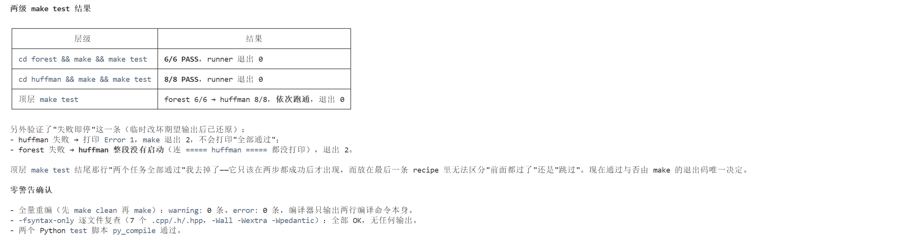

- 先 `make clean` 再 `make`：0 warning、0 error；
- `-fsyntax-only` 复核 7 个 `.cpp` / `.h` / `.hpp`，全部通过；两个 Python 脚本
  `py_compile` 通过；
- 顶层 `make test`：forest 6/6 → huffman 8/8，退出码 0；

---

### 五、运行说明

环境：Windows / Linux 均可，g++ 支持 C++17，Python 3。

```bash
cd MyLab/Tree/Baseline

make            # 编译两个任务
make test       # 依次跑 forest 与 huffman 的样例比对
make clean      # 递归清理 build/

cd forest  && make && make test     # 单独调试 forest
cd huffman && make && make test     # 单独调试 huffman
```

Windows 下把 `make` 换成 `mingw32-make` 即可。两个程序都从标准输入读、向标准输出写：

```bash
./forest/build/forest-demo < forest/inputs/case01.txt
./huffman/build/huffman     < huffman/inputs/case01.txt
printf '1\nA(B(C))\n' | ./forest/build/forest-demo
printf 'hello world\n'  | ./huffman/build/huffman
```

森林任务的第一行是棵数 `k`，随后每行一棵树的括号表示法；哈夫曼任务只读第一行整行
文本，可含空格，空行或空文件输出 `EMPTY` 与 `WPL 0`。非法森林输入会把错误写到
stderr 并返回 1，stdout 不产生半截结果。

---
