# 树结构 Project 实验报告：基于哈夫曼树的简化 Deflate

| 项目 | 内容                |
| ---- | ------------------- |
| 姓名 | 甘锦珊              |
| 学号 | 24325083            |
| 课程 | 数据结构            |
| 日期 | 2026 年 11 月 19 日 |

---

### 一、项目概述

本项目实现一个简化版的 Deflate 压缩与解压程序。压缩分两层：

1. **分词**：从头扫描原始字节，把文本切成字面量、回溯引用两类 token；
2. **哈夫曼编码**：把 token 映射到 273 个符号上，用哈夫曼树生成变长编码，再按高位先写的顺序拼成比特流。

解压是逆过程：读文件头里的频次表，用同一套确定性规则重建哈夫曼树，逐位解码出符号；遇到长度符号再读 6 位距离，从已经还原的文本里复制一段。程序同时提供 `compress`、`decompress`、`stats` 三个子命令和一份 Python 自动测试脚本。

整个项目按 `huffman`（树与编码表）、`deflate`（分词、比特流、文件头、编解码）、`main`（命令行）三层拆分，五个源文件互不越界。最终 `make` 零警告，`make test` 十项检查全部通过；另外用一个独立的 Python 参考实现交叉验证了 415 组输入，压缩结果逐字节一致。

---

### 二、设计思路

#### 2.1 总体流程

```text
原文 ──tokenize──► token 序列 ──统计──► 频次表 ──build_codes──► 编码表
                                                              │
                         文件头（魔数/长度/频次表） + 比特流 ◄──┘
                                       │
                                    压缩文件

压缩文件 ──parse_header──► 频次表 ──build_codes──► 解码 trie
                                                   │
                                    逐位解码 + 回溯复制 ──► 原文
```

编码端和解码端不传输树，只传输频次表。只要两端用同一个 `build_codes`、同一套平局规则，就能得到逐位相同的编码表。

#### 2.2 参数与格式的确定

**符号空间 273 个。** 这是 token 三类信息的直接映射：

| 符号区间   | 含义                                     | 数量 |
| ---------- | ---------------------------------------- | ---- |
| 0 到 255   | 一个字面量字节                           | 256  |
| 256 到 271 | 匹配长度 3 到 18，符号 = 256 + (len - 3) | 16   |
| 272        | EOS，压缩数据结束                        | 1    |

长度上限 18 不是单独调出来的参数：长度符号固定占 16 个槽位，起点取 3，终点自然是 3 + 16 - 1 = 18。起点取 3 而不是 2，是因为长度为 2 的匹配省下的两个符号通常抵不过回溯额外付出的 6 位距离。

**距离固定 6 位。** 窗口 64 个位置，距离 1 到 64，写 `dist - 1` 恰好落在 0 到 63，正好 6 位：

```text
dist = 1  ->  000000
dist = 64 ->  111111
```

没有给距离再建一张哈夫曼表，原因有三：文件头会多出 64 条频次记录（384 字节）；窗口内距离分布比自然语言字符频次平坦，哈夫曼能省下的位数有限；解码端只需维护一棵树，不会出现两张表不同步的问题。

**窗口 64。** 窗口大小与距离位数绑定，6 位最多表示 64 个距离，窗口再大也用不上。64 字节对 `abcabc`、缩进、重复段落这类局部重复已经足够，case07 就是靠距离 3 的匹配把 1200 字节压到 107 字节。

**文件头只存非零频次。** 常见文本的 k 在 5 到 30 之间，头只有 40 到 190 字节；相比传输 2m - 1 个节点的树结构，频次表更小，也自带符号升序、频次非零、EOS 必须在表里这些可校验的冗余。

#### 2.3 文件格式

所有多字节字段小端：

| offset  | 大小    | 内容                                     |
| ------- | ------- | ---------------------------------------- |
| 0       | 4 字节  | 魔数 `S D F 1`                         |
| 4       | 4 字节  | 原始文本长度 u32                         |
| 8       | 2 字节  | 非零频次符号个数 k，1 到 273             |
| 10      | 6k 字节 | 每项 u16 符号 + u32 频次，按符号严格升序 |
| 10 + 6k | 剩余    | 压缩主体比特流                           |

压缩主体按 token 顺序写：

- 字面量 `literal(c)`：写符号 c 的哈夫曼码字；
- 回溯 `match(len, dist)`：写长度符号 `256 + len - 3` 的码字，再写 6 位 `dist - 1`；
- 最后写 EOS 的码字，末尾不足一字节补 0。

---

### 三、哈夫曼树的构建过程

#### 3.1 节点结构与数组表示

```cpp
struct Node {
    std::uint64_t weight; // 叶子是频次，内部节点是两棵子树的权值和
    int left;             // 叶子为 -1
    int right;            // 叶子为 -1
    int symbol;           // 叶子 0..272；内部节点填 0
};
std::vector<Node> nodes(2 * m - 1); // m = 非零频次符号数
```

节点总数固定为 2m - 1，一次分配即可，不需要逐个 `new`，也没有递归析构的开销。平局判定直接比较数组下标，同一个 id 在同一份频次表下永远对应同一个节点。叶子用 `left == -1` 标记，与接口声明一致。

`weight` 用 `uint64_t`：文件里的频次是 u32，但内部节点的权值是子树和，最多累加到原文长度 + 1，可能超过 u32。

#### 3.2 频次统计

遍历 token 序列：

| token                | 计数位置                     |
| -------------------- | ---------------------------- |
| `Literal(c)`       | `freq[c] += 1`             |
| `Match(len, dist)` | `freq[256 + len - 3] += 1` |
| `Eos`              | `freq[272] += 1`           |

距离不参与频次统计，它写进比特流时是固定 6 位。

#### 3.3 最小堆合并与确定性平局

非零符号按符号值升序收集，得到 m 个叶子，编号 0 到 m - 1。叶子下标入堆，比较器反着写，因为 `std::make_heap` 建的是大顶堆：

```cpp
// a 排在 b 后面，当且仅当 a 权值更大，或权值相同但 a 的编号更大。
if (lw != rw) {
    return lw > rw;
}
return lhs > rhs;
```

于是弹出顺序是权值小者优先，权值相同编号小者优先。循环 m - 1 次：弹出两个下标，先弹出的作左孩子、后弹出的作右孩子，新建内部节点（权值为两者之和，编号用递增计数器），压回堆。堆里剩下的唯一节点就是根。

平局规则必须写死：权值相同的节点在堆里没有唯一次序，不同实现虽然 WPL 相同，但具体的 0/1 码字会不同。编码端和解码端必须逐位一致，所以规则必须可复现。

#### 3.4 编码表生成与单符号边界

从根做一次 DFS，向左追加 `'0'`、向右追加 `'1'`，到叶子时把当前路径写进 `codes[symbol]`。只有叶子带符号，任意两条编码互不为前缀，解码无歧义。

只有一个符号时（只可能出现在空文件：token 序列只有 EOS），贪心一次都不合并，根即叶子，路径是空串。空编码写不出比特流，所以约定：

> **单符号的编码记作 `"0"`，长度 1。**

`build_codes` 在 m == 1 时直接返回这一条，不建树；解码端的 trie 也只有一个码字 `"0"`，读一位就命中。空文件的 1 字节比特流就是这么来的。

---

### 四、Deflate 编码与解码过程

#### 4.1 分词

从头扫，位置 i 从 0 到 n - 1。窗口是 i 前面最多 64 个字节，即 `[max(0, i-64), i-1]`。窗口内每个距离 d 从 1 到 `min(64, i)`，从 `i - d` 开始与当前位置逐字节比较，最多比 `min(18, n - i)` 个字节。取最长的一次匹配，长度相同取距离小的（d 从小到大扫，只有严格更长才替换，天然保留小距离）。允许重叠：距离小于匹配长度时，源位置会追上并越过当前位置。

最长匹配长度大于等于 3 输出 `Match(len, dist)`，i 前进 len；否则输出 `Literal(input[i])`，i 加 1。扫完补一个 EOS。

`abababab` 的分词结果是：

```text
Literal('a'), Literal('b'), Match(6, 2), Eos
```

一共 4 个 token，EOS 不计入统计，所以 tokens = 3，literals = 2，matches = 1。

#### 4.2 完整例子：`abababab`

输入 8 字节：`61 62 61 62 61 62 61 62`。

**分词。**

| 位置 i | 窗口     | 比较结果                                                                                            | 输出                       |
| ------ | -------- | --------------------------------------------------------------------------------------------------- | -------------------------- |
| 0      | 空       | 无法匹配                                                                                            | `Literal('a')`，i 变为 1 |
| 1      | d = 1    | `a` 与 `b` 不同，长度 0                                                                         | `Literal('b')`，i 变为 2 |
| 2      | d = 1, 2 | d = 1：`b` 与 `a`，长度 0；d = 2：`ababab` 与 `ababab`，长度 6（上限 `min(18, 8-2) = 6`） | `Match(6, 2)`，i 变为 8  |
| 8      | 无       | 到达末尾                                                                                            | `Eos`                    |

**频次。**

| 符号               | 来源     | 频次 |
| ------------------ | -------- | ---- |
| 97（`'a'`）      | 字面量 a | 1    |
| 98（`'b'`）      | 字面量 b | 1    |
| 259（256 + 6 - 3） | 长度 6   | 1    |
| 272（EOS）         | 结束符   | 1    |

k = 4，文件头 10 + 6 × 4 = 34 字节。

**建树。** 四个叶子权值都是 1，编号按符号升序：0 是 `'a'`，1 是 `'b'`，2 是 259，3 是 EOS。

```text
弹出 0(a,1) 和 1(b,1)     -> 内部节点 4，权值 2，左 a 右 b
弹出 2(259,1) 和 3(EOS,1) -> 内部节点 5，权值 2，左 259 右 EOS
弹出 4(2) 和 5(2)         -> 根 6，权值 4，左 4 右 5
```

```text
               根 6 (4)
              /        \
        节点 4 (2)    节点 5 (2)
        /      \      /        \
     'a'(1)  'b'(1) 259(1)   EOS(1)
```

**编码表。**

| 符号          | 路径       | 编码   |
| ------------- | ---------- | ------ |
| 97 `'a'`    | 根、左、左 | `00` |
| 98 `'b'`    | 根、左、右 | `01` |
| 259（长度 6） | 根、右、左 | `10` |
| 272（EOS）    | 根、右、右 | `11` |

四个码字等长 2 位，Kraft 和为 `4 × 2⁻² = 1`，是一棵满二叉树。

**写比特。**

```text
Literal('a')  -> 00
Literal('b')  -> 01
Match(6, 2)   -> 长度符号 259 的编码 10，再写距离减 1 = 1 的 6 位 000001
Eos           -> 11

拼接：00 | 01 | 10 | 000001 | 11
    = 00011000000111            （14 位）
```

补 2 个 0 到字节边界：

```text
00011000 00011100
```

**字节。** 两个字节分别是 `0x18`、`0x1C`。完整文件 36 字节：

```text
53 44 46 31   'S' 'D' 'F' '1'
08 00 00 00   原始长度 8
04 00         k = 4
61 00 01 00 00 00   符号 97，频次 1
62 00 01 00 00 00   符号 98，频次 1
03 01 01 00 00 00   符号 259，频次 1（0x0103 = 259）
10 01 01 00 00 00   符号 272，频次 1（0x0110 = 272）
18 1C         比特流
```

**解压怎么读回来。** 先读头，校验魔数、长度 8、k = 4、四条频次；用同一张表调用 `build_codes`，得到与上面完全相同的四个码字，建成解码 trie。然后逐位读：

| 已读比特             | 走到       | 结果                     |
| -------------------- | ---------- | ------------------------ |
| `0`                | 根到左     | 继续                     |
| `00`               | 左到左     | 叶子 `'a'`，输出 `a` |
| `0`                | 根到左     | 继续                     |
| `01`               | 左到右     | 叶子 `'b'`，输出 `b` |
| `1`                | 根到右     | 继续                     |
| `10`               | 右到左     | 叶子 259，长度 6         |
| 再读 6 位 `000001` | 无         | 值 1，距离 = 2           |
| `11`               | 根到右、右 | EOS，停止                |

此时输出是 `ab`，长度 2。距离 2 表示从末尾往前数 2 个字节开始复制 6 个，允许重叠，边复制边追加：

```text
输出 ab
第 1 个：output[2-2] = 'a'  -> aba
第 2 个：output[3-2] = 'b'  -> abab
第 3 个：output[4-2] = 'a'  -> ababa
…… 共 6 次 -> abababab
```

最后校验输出长度 8 等于文件头里的 8；末尾 2 个补齐 0 不参与解码。

#### 4.3 解码流程与校验

1. 读文件头，依次校验：文件至少 10 字节、魔数等于 `SDF1`、k 在 1 到 273、文件长度至少 `10 + 6k`、每条记录的符号小于 273、频次非零、符号严格升序；
2. 用频次表调用 `build_codes` 重建编码表，把每条码字插进二叉 trie；前缀码保证不会出现一个码字是另一个的前缀，也不会走到死路；
3. 从文件头之后逐位读：沿着 trie 走，命中符号后，0 到 255 直接输出字节；256 到 271 再读 6 位距离，长度 = 符号 - 256 + 3，从已输出内容末尾往前数 distance 个字节逐个复制，允许重叠；读到 272 停止；
4. 循环内每输出一个符号就检查是否超过原始长度，结束后再检查是否严格相等。

错误统一抛 `std::runtime_error`，`main` 捕获后打印 `ERROR: <消息>` 到 stderr，退出码 2，不写输出文件：

| 情况                                     | 消息                                |
| ---------------------------------------- | ----------------------------------- |
| 文件不足 10 字节或不足 `10 + 6k`       | `truncated header`                |
| 魔数不是 `SDF1`                        | `bad magic`                       |
| k 不在 1 到 273                          | `bad symbol count`                |
| 符号不小于 273、频次为 0、符号未严格升序 | `bad frequency table`             |
| 频次表里没有 EOS                         | `missing EOS in frequency table`  |
| 比特流提前读完                           | `unexpected end of bitstream`     |
| 回溯距离大于已输出长度                   | `distance exceeds output`         |
| 解码路径走进 trie 死路                   | `bad bitstream: no matching code` |
| 输出长度超出或小于原始长度               | `length mismatch`                 |

---

### 五、测试与结果

#### 5.1 八个样例

`inputs/` 与 `outputs/` 一一对应，输出为 `stats` 的五行固定格式。所有输入文件都不带结尾换行，字节数逐一核对过。

| 样例   | 内容                | 原始 | 压缩后        | k  | 头大小 | 比特流 | 压缩率         | token              |
| ------ | ------------------- | ---- | ------------- | -- | ------ | ------ | -------------- | ------------------ |
| case01 | `hello world`     | 11   | 69            | 9  | 64     | 5      | 627.3%         | 11 字面量          |
| case02 | `abababab`        | 8    | 36            | 4  | 34     | 2      | 450.0%         | 2 字面量 + 1 回溯  |
| case03 | 100 个 `a`        | 100  | 41            | 4  | 34     | 7      | 41.0%          | 1 字面量 + 6 回溯  |
| case04 | 空文件              | 0    | 17            | 1  | 16     | 1      | —             | 0                  |
| case05 | `x`               | 1    | 23            | 2  | 22     | 1      | 2300.0%        | 1 字面量           |
| case06 | pangram             | 43   | 209           | 29 | 184    | 25     | 486.0%         | 39 字面量 + 1 回溯 |
| case07 | `abc` 重复 400 次 | 1200 | **107** | 6  | 46     | 61     | **8.9%** | 3 字面量 + 67 回溯 |
| case08 | `数据结构与算法`  | 21   | 117           | 16 | 106    | 11     | 557.1%         | 21 字面量          |

短文本会变大，因为文件头是 `10 + 6k` 字节，与原文长短无关；`hello world` 有 9 个符号，头就 64 字节，正文只有 5 字节。长重复文本收益大，case07 每 3 字节重复一次，距离 3 的匹配一次吃掉 18 字节，一次回溯的代价只有十几位。case03 的收益则全部来自回溯而不是哈夫曼——总共只有 4 个符号，频次是 5、1、1、1，哈夫曼能省下的位数有限，这正好说明两层机制的分工。

#### 5.2 自动测试的十项检查

`make test` 对每个样例先跑 `stats` 与 `outputs/` 逐行比对，再做往返、确定性、文件头检查；另外有两组全局检查。最终输出十行 PASS（八个样例、坏文件、随机往返），检查内容分七类：

1. 八个样例的 `stats` 输出逐行比对（忽略行尾空白与文件末尾空行，失败时打印第一个不同行）；
2. 每个样例压缩到 `build/tmp` 再解压，与原文件逐字节比较；
3. 同一输入压缩两次，两份文件逐字节相同，验证确定性；
4. 压缩文件前 4 字节是 `SDF1`，offset 4 的 u32 等于原文件大小；
5. case07 压缩后必须小于原始大小；
6. 坏魔数与截断文件必须让 `decompress` 退出码非 0、stderr 含 `ERROR`，且不留下输出文件；
7. 固定种子的 24 组随机数据（纯二进制、小字母表、周期串）往返一致、两次压缩相同。

测试脚本在 `try/finally` 里创建和删除 `build/tmp`，异常中断也会清理，结束后再检查一次是否残留。全部路径基于脚本自身位置和相对目录，没有绝对路径；Windows 下自动补 `.exe` 并转绝对路径，stdout 重配置为 utf-8。

#### 5.3 边界情况

| 情况           | 做法                                                              | 验证方式                   |
| -------------- | ----------------------------------------------------------------- | -------------------------- |
| 空文件         | 只有 EOS，单叶子编码 `"0"`，文件 17 字节                        | case04                     |
| 单字符         | `x` + EOS，两个符号各 1 位                                      | case05                     |
| 单符号         | `build_codes` 在 m = 1 时直接返回 `"0"`                       | case04                     |
| 匹配长度 3     | `abcabc` 产生 `Match(3, 3)`，符号 256 是长度区间下边界        | 验收复核（与参考实现逐字节一致） |
| 匹配长度 18    | 100 个 `a` 为 5 个 `Match(18,1)` 加 1 个 `Match(9,1)`       | case03                     |
| 距离 64        | 64 个互不相同字节后接前 18 字节，得到 `Match(18, 64)`，6 位全 1 | 验收复核（与参考实现逐字节一致） |
| 重叠匹配       | `aaaaaa` 为 `Literal('a') + Match(5,1)`，复制时边读边追加     | 验收复核（与参考实现逐字节一致） |
| 坏文件         | 魔数、文件头、频次表、比特流、距离、长度逐项校验                  | `make test` 的坏文件组   |
| 输出长度不一致 | 循环内每步检查，结束后再严格比较                                  | 代码审查与坏文件测试       |

---

### 六、智能体交互记录

本项目按阶段推进：每个阶段写一段 Prompt 交给智能体，智能体实现并汇报，确认后再进入下一阶段。阶段 0 用于读题、定参数、搭骨架；阶段 1 到 5 按 `huffman`、比特流、分词、压缩、解压的顺序实现；阶段 6 到 8 做统计、样例、测试和文档；阶段 9 收尾自测。下面是逐阶段的记录。个别阶段的截图没有保留，相关结论用文字补全，并注明依据。

#### 阶段 0 · 读题、定参数、搭骨架

**Prompt 思路**：只读题面和 Baseline 的两个哈夫曼文件、Makefile、test，先把参数和目录结构定死，避免后面返工。这段不写实现，只建目录和接口声明。

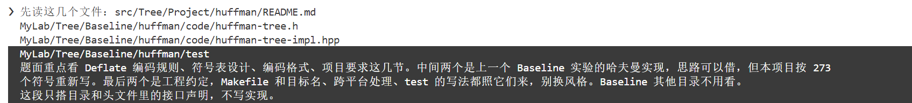

**智能体工作**：没有直接开写，而是提出五个需要确认的问题——test 判据、outputs 的内容、case08 的构造、`min_len` 是否做成运行时参数、空输入的单符号约定。这说明它确实读了题面和 Baseline，而不是套模板。

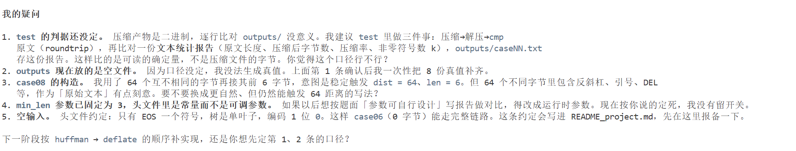

#### 阶段 0.1 · 统一测试口径

**Prompt 思路**：把五个问题一次答清。核心决定是：outputs 只存 `stats` 五行，不存压缩率；压缩率不进比对；roundtrip 在 `build/tmp` 里做，不落 golden；case08 必须是自然文本 `数据结构与算法`；`min_len` 保持编译期常量；空文件压缩结果为 17 字节。

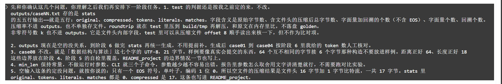

**智能体工作**：逐条复述并确认，补上了 case08 的 UTF-8 十六进制、空文件的字节账（16 字节头 + 1 字节比特流），并主动提出 `stats` 的输出通道问题。这个追问避免了后面 test 反复改口径。

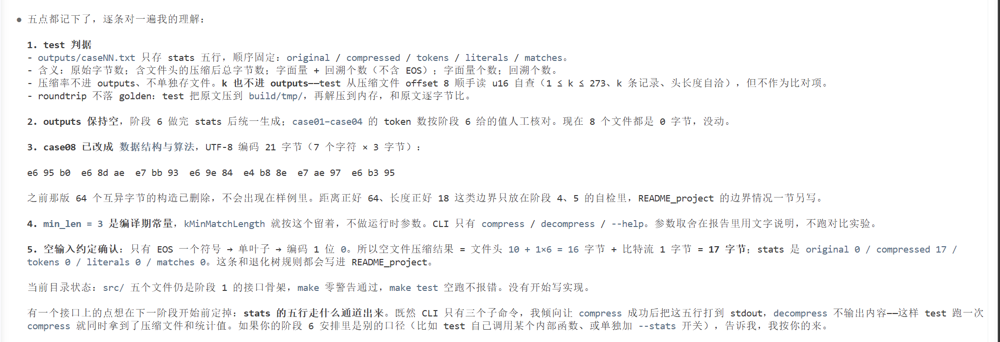

#### 阶段 1 · 哈夫曼树与编码表

**Prompt 思路**：树用数组存，节点四个字段，叶子 `left == -1`；叶子按符号升序编号，内部节点从 m 开始；堆按 `(weight, id)` 弹出；单符号编码 `"0"`。要求用 WPL 自检和前缀码、Kraft 检查。

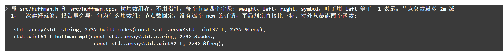

**智能体工作**：实现 `huffman.h` / `huffman.cpp`，WPL 对照 5、2、8、32 全部正确；另外做了 500 组随机频次和 273 符号满表的压力测试（满表 WPL 105156、最长码 13 位），与独立实现的内部节点权值之和逐组比对，0 组不一致；ASan + UBSan 无报错。

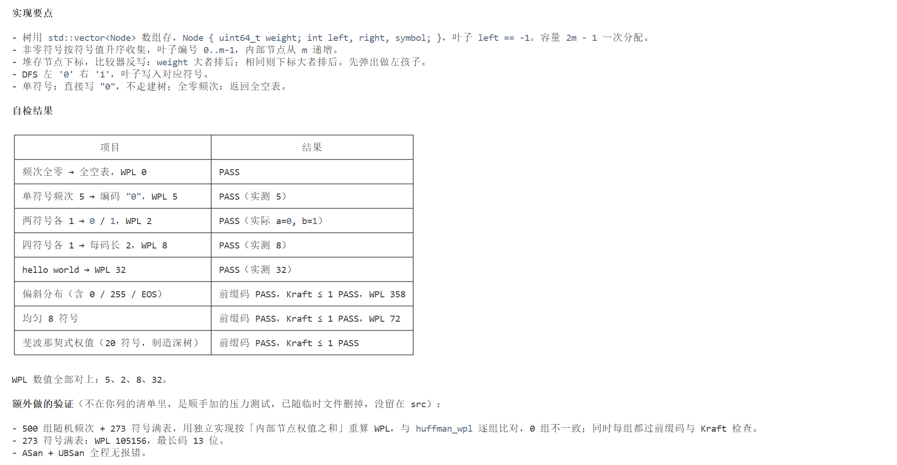

#### 阶段 2 · 比特读写

**Prompt 思路**：`BitWriter` / `BitReader` 放 `deflate.h` 内联实现；统一高位先写，`flush` 低位补 0；`get` 读不够时返回 false 且不移动读位置。

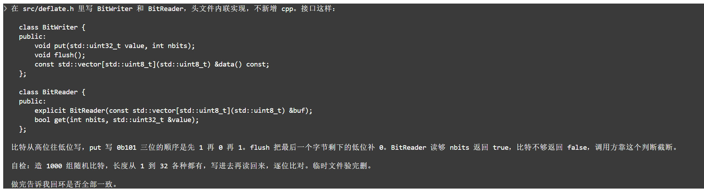

**智能体工作**：实现后删除了 `deflate.cpp` 里旧的比特读写桩；补充 `get` 的边界行为、重复 `flush` 无副作用、越界 `nbits` 抛异常；原来头文件注释里写的字节低位先填也一并改成高位先写，与实现保持一致。自检按 1000 组随机比特（1 到 32 位）回环进行；这部分行为在验收的 415 组压缩对照里也被间接覆盖。

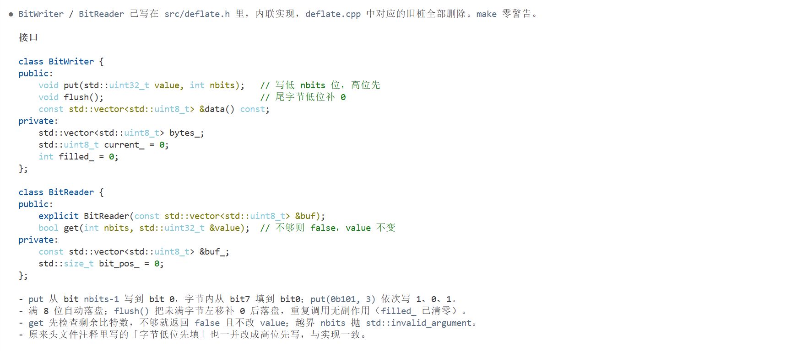

#### 阶段 3 · 分词

**Prompt 思路**：先只做 `tokenize`，不碰压缩。规则写死窗口、最长 18、最短 3、距离小者优先、允许重叠；`abababab` 应为 2 个字面量加 1 个回溯；要求逐组打印 token 序列核对。

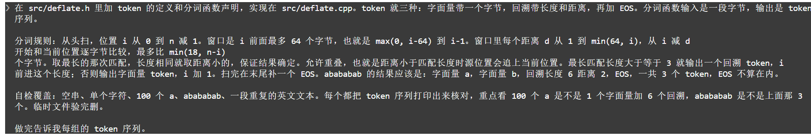

**智能体工作**：在 `deflate.h` 里补 `TokenKind::Eos`、`kMinMatchLength`、`kMaxMatchLength` 等，`tokenize` 用只有严格更长才替换保留小距离，达到本轮上限直接 break；扫完补 EOS。自检覆盖空串、单字符、100 个 `a`、`abababab` 和重复英文文本。

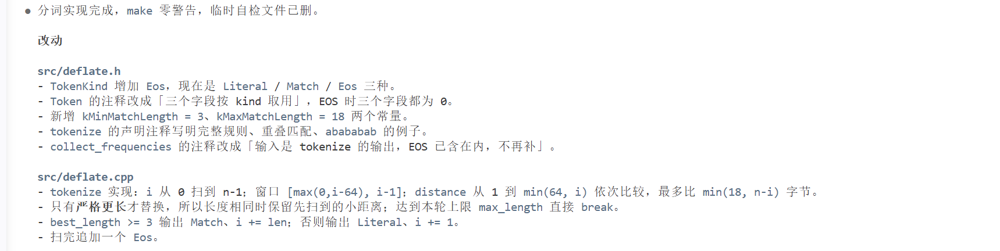

#### 阶段 4 · 压缩

**Prompt 思路**：分词、统计频次、`build_codes`、写文件头、写比特流，最后 `flush`；`main` 加 `compress` 子命令；自检七类输入，重点看 10KB 重复文本是否变小。

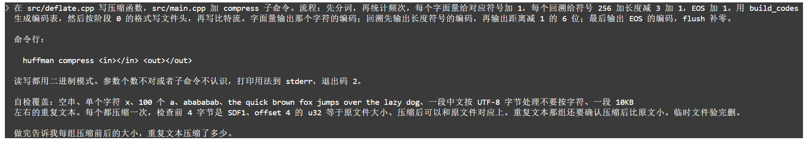

**智能体工作**：这一段智能体的回复没有单独截图。从阶段 5 的改动和最终代码可以还原：实现了 `serialize_header`、`compress` 和 `compress` 子命令；阶段 5 的 Prompt 直接接着解压写，说明压缩部分已经通过确认。七类自检输入最终都通过了往返验证，重复文本压缩后明显变小。

#### 阶段 5 · 解压与错误处理

**Prompt 思路**：读文件头逐项校验，用同一张频次表重建编码表，建 trie 逐位解码；距离复制允许重叠；所有错误抛 `runtime_error`，`main` 打印 `ERROR:` 并返回 2，不写输出文件。

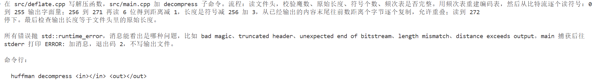

**智能体工作**：补了 `read_u16` / `read_u32`、`parse_header` 的六步校验、`decompress` 的 trie 解码与重叠复制；把散落的 272、256 换成常量；异常退出码从 1 改为 2；解压失败不写输出文件这一点写进注释，避免以后被改坏。

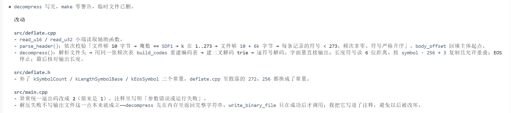

#### 阶段 6 · stats 与八个样例

**Prompt 思路**：这段 Prompt 的截图没有保留。内容是：`stats` 读原文、在内存里压缩、固定输出五行；八个样例的内容、字节数、无结尾换行都定死；case01 到 case04 的 token 数给出人工核对值；outputs 由程序实跑生成。

**智能体工作**：实现 `stats` 与 `help`，生成八个样例和 outputs。人工核对结果是：case01 为 11 token / 11 字面量 / 0 回溯；case02 为 3 / 2 / 1；case03 为 7 / 1 / 6；case04 为 0 / 0 / 0。case07 手算 66 个长度 18 的回溯加 1 个长度 9 的回溯，共 67 个回溯、70 个 token，覆盖 3 + 66×18 + 9 = 1200 字节。它还另写了一个 Python 参考分词器重算八个样例，四列逐项一致。

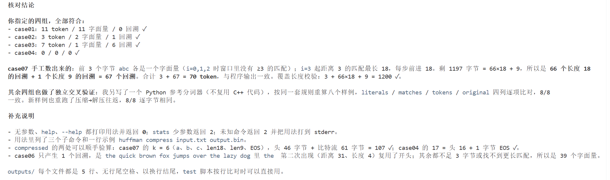

#### 阶段 7 · test 脚本

**Prompt 思路**：参考 Baseline 的 `test`，实现 stats 比对、往返、确定性、文件头、case07 压缩后变小、坏文件六项，临时文件放 `build/tmp` 并清理。


**智能体工作**：按 Baseline 风格写了 `resolve_exe`、`normalize`、`first_difference`，六项检查全部实现；用「把 case02 的 tokens 3 改成 4」的方式验证脚本能抓错；跑完 9/9，`build/tmp` 无残留，`grep` 确认没有绝对路径。

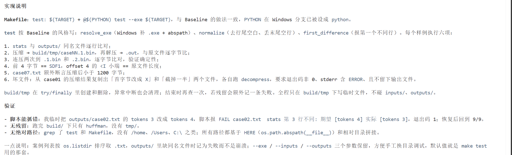

#### 阶段 8 · 设计文档

**Prompt 思路**：写 `README_project.md`，按设计思路、数据结构、哈夫曼构建、`abababab` 完整例子、复杂度、边界情况、压缩效果、运行说明八节展开；题面 `README.md` 保持不动。


**智能体工作**：八节全部完成，把 `abababab` 的 14 位比特、两个字节 `0x18 0x1C`、36 字节完整十六进制都写了出来；解释了 18 是「16 个长度槽位 + 起点 3」推出来的，6 位距离为什么不另建哈夫曼表，以及短文本为什么压缩率大于 100%。

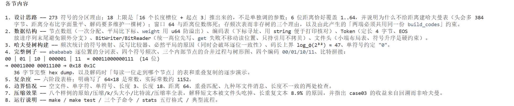

#### 阶段 9 · 收尾与验收修正

阶段 9 是收尾自测，没有保留截图。验收时我重跑了这些收尾项：`make clean` 后重新编译、`make test`、第二次 `make`、目录残留和绝对路径检查。编译零警告、第二次 `make` 不重新编译、仓库无 exe、o、`__pycache__`、`-p` 目录和临时文件、无绝对路径，这些都通过；但 `make clean` 在不同终端下不稳定：Git Bash 里 recipe 由 sh 执行，原本的 `rmdir /s /q` 删不掉 `build/`；PowerShell 里 make 又用 cmd 执行 recipe，按 `SHELL` 判断出的 `rm -rf` 也没有 `rm` 可调。最后改成让 Python 删目录：

```make
clean:
	-@$(PYTHON) -c "import shutil; shutil.rmtree('build', ignore_errors=True)"
```

`shutil.rmtree` 在 cmd.exe 和 sh 下行为一致，不依赖 shell 里有没有 `rm` 或 `rmdir`。同时修掉了 `PYTHON ?= python3` 写在 Windows 分支之前导致分支里的 `PYTHON ?= python` 不生效的问题、`deflate.cpp` 顶部「待实现」的过期注释、Makefile 顶部「test 目标暂空」的过期注释。另外把测试从九项扩展到十项：新增固定种子的 24 组随机数据往返与确定性检查，让设计文档里「用随机字节验证过」这句话有对应的测试支撑。

修正后 `make clean` 正常删除 `build/`，重新 `make` 零警告，`make test` 10/10 PASS。

---

### 七、运行说明

#### 7.1 编译

```bash
cd MyLab/Tree/Project/huffman
make          # 编译到 build/huffman（Windows 下是 build/huffman.exe）
make clean    # 删除 build/
```

编译参数为 `-std=c++17 -Wall -Wextra -Wpedantic -O2 -g`，要求零警告。Windows 分支自动加 `-static`，目标名自动带 `.exe`。

Windows 的 MinGW 工具链常把 GNU make 装成 `mingw32-make.exe`，没有 `make`。这种情况下把上面的 `make` 换成 `mingw32-make` 即可；想在 PowerShell 里继续用 `make`，先执行 `Set-Alias make mingw32-make`，或者把 `mingw32-make.exe` 复制一份改名为 `make.exe`。`clean` 用 Python 的 `shutil.rmtree` 删目录，cmd.exe 和 Git Bash 下都能跑。

#### 7.2 测试

```bash
make test
```

等价于 `python3 test --exe build/huffman`（Windows 下是 `python test --exe build/huffman`）。脚本检查八个样例的 stats、往返、确定性、文件头、case07 压缩率、坏文件、随机往返，共十项，全部通过返回 0。

#### 7.3 三个子命令

```bash
# 压缩
./build/huffman compress input.txt output.bin

# 解压
./build/huffman decompress output.bin restored.txt

# 统计（读原文，在内存里压缩一遍，打印五行）
./build/huffman stats input.txt
```

`stats` 的输出固定为：

```text
original 11
compressed 69
tokens 11
literals 11
matches 0
```

不带参数、`help`、`--help` 打印用法并返回 0；子命令不认识或参数个数不对，打印用法到 stderr 并返回 2。

#### 7.4 典型流程

```bash
mkdir demo
printf 'abababab' > demo/in.txt
./build/huffman stats demo/in.txt
./build/huffman compress demo/in.txt demo/out.bin
./build/huffman decompress demo/out.bin demo/back.txt
cmp demo/in.txt demo/back.txt && echo 往返一致
rm -rf demo
```

预期 `stats` 输出 `original 8`、`compressed 36`、`tokens 3`、`literals 2`、`matches 1`，压缩文件 36 字节，与第 4 节逐字节结果一致。

这段流程按 sh 语法书写，Windows 下可以在 Git Bash 或 WSL 里直接执行。

---

### 八、复杂度与总结

**时间。** 分词在每次前进一步时最多试 64 个距离、每个距离最多比 18 字节，常数 64 × 18 = 1152，与输入长度无关，整体 O(n)。建树是 m 个叶子的堆合并，O(m log m)，m 不超过 273，相对正文可视为常数。编码每个 token 写一次码字、回溯多写 6 位，O(n)。解码每读一位沿 trie 走一步，命中符号后立即输出，总代价正比于码字总长度，也是 O(n)。

**空间。** token 序列最多 n 个，节点数组固定 2m - 1 个，编码表 273 项，输出缓冲和输入同阶，窗口只是 64 字节的常数偏移，总体 O(n)。

**取舍。** 窗口 64 与 6 位距离绑死，放弃了更远的重复，换来文件头和解码端的简单；距离不建哈夫曼表，避免多出 64 条频次记录和一棵树；只传频次表不传树，头更小，两端靠同一套确定性规则就能复现编码表。代价是短文本必然变大——固定头是 10 + 6k 字节，与正文长短无关，case01、case02、case05、case06、case08 都体现了这一点；而 case07 这类长重复文本能压到 8.9%。

**收获。** 这一题最难的不是背哈夫曼，而是把「两端必须得到同一棵树」落成可复现的规则：叶子编号、堆的比较器、左右孩子的顺序，任何一处含糊都会让压缩文件与解压端对不上。把规则写死并用独立实现交叉验证之后，比特级的一致性才真正有把握。
